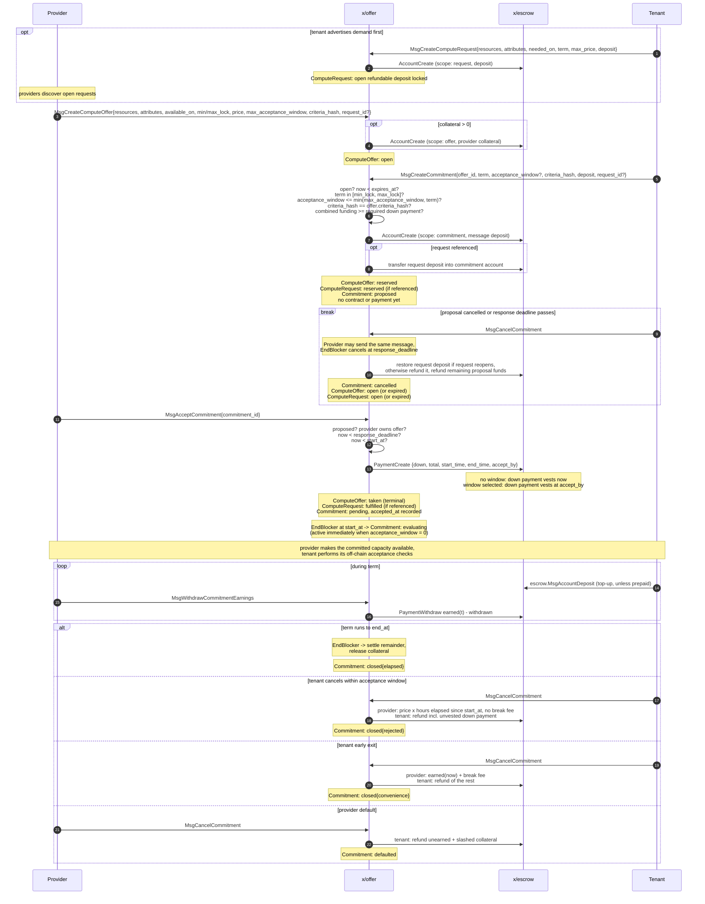
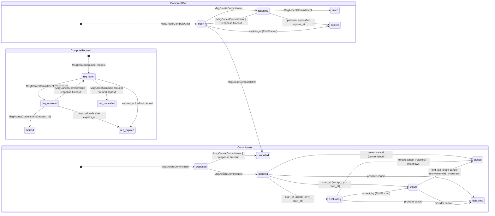

## Scope

This AEP defines an on-chain way to reserve compute capacity in advance at a fixed price.
A provider publishes a fixed bundle of CPU, memory, GPU, and storage. A tenant may reserve
that entire bundle for a term that starts at a specified wall-clock date. The tenant fixes
the proposed economic terms when creating a commitment, and those terms become binding only
when the provider explicitly accepts them.

The design must satisfy these requirements:

1. Offers are focused on resources: cpu, mem, gpu, storage.
2. An offer specifies a start **date**, not a block height, and limits the duration a tenant
   may reserve.
3. Detailed acceptance criteria remain off-chain.
4. A tenant proposal followed by explicit provider acceptance creates a lease-like
   agreement that uses on-chain escrow, but it is not the existing Akash market lease.
5. Both sides publish independently: a provider publishes its offers, and a tenant publishes
   its requests. A tenant selects an offer and proposes a commitment; the provider must
   explicitly accept it. A request never binds anyone.
6. A small attribute vocabulary lets each side describe the type of capacity it offers or
   needs, such as a VM or a bare-metal machine.

The module is self-contained: it defines offers, requests, and the commitments formed from
them, nothing else. Marketplaces or financial products built on top stay off-chain and use
the same messages as everyone else; nothing in this module depends on their existence.

### How it works

The flow is:

1. A provider publishes a `ComputeOffer` for a specific bundle of capacity, start date,
   permitted term range, and hourly price.
2. After inspecting the provider and offer, a tenant chooses a term and optional acceptance
   window, funds escrow, and creates a proposed `Commitment`. The offer becomes reserved
   while the provider reviews the proposal and tenant.
3. The provider explicitly accepts or cancels the proposal before its response deadline.
   Provider acceptance forms the contract and fixes the capacity, price, start date, end
   date, and off-chain criteria hash.
4. At `start_at`, hourly accrual begins and the acceptance window opens. While the window is
   open, the tenant evaluates the capacity and may cancel without an additional penalty
   after paying for the elapsed hours. A no-window down payment may already have vested when
   the provider accepted the proposal.
5. If the tenant does not cancel, the commitment becomes fully active at `accept_by`. The
   provider continues earning according to the commitment's wall-clock schedule.

A tenant may publish a `ComputeRequest` before step 1 to advertise demand. Creating a
request locks a refundable deposit as evidence of intent. The request still reserves no
capacity and creates no obligation for a provider. A contract exists only after the tenant
proposes a commitment and the provider explicitly accepts it.

### Terminology

| Term                    | Meaning in this AEP                                                                                                                                                                                |
|-------------------------|----------------------------------------------------------------------------------------------------------------------------------------------------------------------------------------------------|
| **Offer**               | A provider's non-binding listing of one indivisible bundle of compute capacity.                                                                                                                    |
| **Request**             | A tenant's non-binding advertisement of demand, backed by a refundable intent deposit.                                                                                                             |
| **Propose**             | The tenant action that reserves an open offer and creates a proposed commitment.                                                                                                                   |
| **Provider acceptance** | The provider action that accepts the tenant's commitment request and forms the contract. It does not mean that the tenant has accepted the delivered capacity.                                     |
| **Commitment**          | A tenant proposal that becomes a capacity lease when the provider accepts it.                                                                                                                      |
| **Notional**            | The total price for the selected term: hourly price multiplied by term hours.                                                                                                                      |
| **Acceptance window**   | An optional period after the term starts during which the tenant performs its acceptance checks. The tenant may reject the capacity after paying for elapsed hours, without an additional penalty. |
| **Criteria**            | Off-chain terms identified on-chain by `criteria_hash`.                                                                                                                                            |

## Context

The existing Akash market cannot represent this agreement for the following reasons:

| Current behaviour                                                          | Verified at                                                                             | Why it blocks offers                                                                     |
|----------------------------------------------------------------------------|-----------------------------------------------------------------------------------------|------------------------------------------------------------------------------------------|
| A `Lease`'s identity *is* a `BidID` (`owner/dseq/gseq/oseq/provider/bseq`) | `chain-sdk` `market/v2beta1/lease.proto`                                                | A commitment has no deployment identity and therefore no `dseq`/`gseq` to key on.        |
| Escrow payments accrue `rate × (BlockHeight − SettledAt)`                  | [keeper.go](https://github.com/akash-network/node/blob/main/x/escrow/keeper/keeper.go)  | An offer's term is wall-clock; block-rate accrual drifts against the agreed dates        |
| Escrow `Scope` enum has only `deployment` and `bid`                        | `chain-sdk` `escrow/id/v1/id.proto`                                                     | Request deposits, offer collateral, and commitment funds have no scope to live under     |
| Price discovery runs `Order` → `Bid` per deployment                        | [server.go](https://github.com/akash-network/node/blob/main/x/market/handler/server.go) | An offer is provider-initiated and deployment-less; the auction runs the wrong direction |

The implementation reuses the existing `x/escrow` account, payment, deposit authorization,
and AKT-to-ACT conversion mechanisms. It also follows the wall-clock precedent established
by `market/v1.Reclamation` and the repository's existing `collections` and manual pagination
conventions.


> **Naming collision.** `akash.market.v2beta1.ResourceOffer` already exists: the provider's
> per-resource-unit offer *inside a bid*. New types live in `akash.offer.v1` and are named
> `ComputeOffer`/`ComputeRequest`/`Commitment`, never `ResourceOffer`.

## Decision

Add a new **`x/offer`** module with three objects:

* **`ComputeOffer`:** A provider's standing listing of capacity for a future term. It is
  non-binding until a provider accepts a commitment proposed against it. A tenant proposal
  reserves the offer while the provider reviews the tenant and proposed terms.
* **`ComputeRequest`:** A tenant's standing advertisement of demand, backed by a refundable
  deposit that demonstrates funded intent. The deposit remains tenant-owned and cannot be
  claimed by a provider. A provider may respond by publishing an offer that references the
  request. The tenant then decides whether to propose a commitment, and the provider decides
  whether to accept that proposal.
* **`Commitment`:** First a tenant's proposal against an offer, then the agreement formed
  by explicit provider acceptance. An accepted commitment is a **capacity lease** rather
  than the existing market's **workload lease**.

Offers and requests are both advertisements and bind neither party by themselves. Locking a
request deposit does not give any provider a claim to it; the tenant may recover it by
closing the request. A tenant creates a commitment proposal after inspecting an offer and
provider. The provider then inspects the tenant and proposal. A contract is formed only when
the provider explicitly accepts that proposal.

The module depends on `escrow` for funds and `provider` to verify that an offer's signer is a
registered provider. It has **no dependency on `deployment`, `market.Order`, or
`market.Bid`**.

### `ComputeOffer`

```protobuf
// akash/offer/v1/offer.proto

message OfferID {
  // Provider is the bech32 account address of the offering provider.
  string provider = 1 [(cosmos_proto.scalar) = "cosmos.AddressString"];
  // Seq is a monotonic per-provider offer sequence.
  uint64 seq = 2 [(gogoproto.customname) = "Seq"];
}

message ComputeOffer {
  enum State {
    invalid   = 0 [(gogoproto.enumvalue_customname) = "OfferStateInvalid"];
    // open: available for a tenant to propose a commitment against, in whole.
    open      = 1 [(gogoproto.enumvalue_customname) = "OfferOpen"];
    // reserved: a tenant proposed a commitment; the provider has not accepted it yet.
    reserved  = 2 [(gogoproto.enumvalue_customname) = "OfferReserved"];
    // taken: the provider accepted a commitment against this offer. This is terminal. If
    // the accepted commitment later closes early, the provider posts a new offer.
    taken     = 3 [(gogoproto.enumvalue_customname) = "OfferTaken"];
    // cancelled: provider withdrew the offer before it was taken.
    cancelled = 4 [(gogoproto.enumvalue_customname) = "OfferCancelled"];
    // expired: expires_at passed untaken.
    expired   = 5 [(gogoproto.enumvalue_customname) = "OfferExpired"];
  }

  OfferID id    = 1 [(gogoproto.customname) = "ID"];
  State   state = 2;

  // Resources is the capacity offered for lease, as a whole: cpu, memory, gpu, storage
  // (requirement 1). An offer is INDIVISIBLE. Proposals cover it in whole or not at all. A
  // provider wanting to lease parts of a machine partitions it itself (e.g. into VMs) and
  // posts one offer per partition.
  // Endpoints MUST be empty. An endpoint describes how a workload is reached, not a
  // quantity of capacity. Provisioning and access details remain off-chain.
  akash.base.resources.v1beta4.Resources resources = 3 [(gogoproto.nullable) = false];

  // Attributes describe the offered capacity beyond raw quantities, using the basic
  // vocabulary (requirement 6), for example machine-type=vm or machine-type=baremetal.
  // See "Basic attributes": reserved keys are validated, machine-type is mandatory.
  repeated akash.base.attributes.v1.Attribute attributes = 4 [
    (gogoproto.castrepeated) = "pkg.akt.dev/go/node/types/attributes/v1.Attributes",
    (gogoproto.nullable)     = false
  ];

  // AvailableOn is the wall-clock date the capacity becomes available (requirement 2: a
  // date, not a block). A commitment's term starts here.
  google.protobuf.Timestamp available_on = 5 [(gogoproto.stdtime) = true, (gogoproto.nullable) = false];

  // MinLock/MaxLock bound the term the Commitment may lock, measured from AvailableOn:
  // end_at = available_on + term, term in [min_lock, max_lock]. MaxLock is requirement 2's
  // "how long it can be locked for"; MinLock keeps dust terms off the books.
  google.protobuf.Duration min_lock = 6 [(gogoproto.stdduration) = true, (gogoproto.nullable) = false];
  google.protobuf.Duration max_lock = 7 [(gogoproto.stdduration) = true, (gogoproto.nullable) = false];

  // ExpiresAt is the exclusive deadline for creating a proposal. Must be <= available_on.
  google.protobuf.Timestamp expires_at = 8 [(gogoproto.stdtime) = true, (gogoproto.nullable) = false];

  // Price for the offered resources as a whole, per hour. Never per block. See "Pricing
  // basis". Existing escrow denomination rules apply, and escrow's bme hook converts AKT
  // deposits so tenants can fund in AKT.
  cosmos.base.v1beta1.DecCoin price = 9 [(gogoproto.nullable) = false];

  // CriteriaHash is sha256 of the canonical off-chain acceptance-criteria document
  // (requirement 3). The chain never interprets it; it only records the document hash
  // explicitly approved by both parties. Document discovery stays entirely off-chain.
  bytes  criteria_hash = 10;
  reserved 11;

  // DownPaymentBps OPTIONALLY requires a share of the commitment's notional at commitment
  // creation, in basis points. It is the provider's choice per offer, not a protocol
  // requirement: zero (the default) means no down payment and the whole notional accrues
  // per hour across the term. When no acceptance window is selected, the down payment
  // vests when the provider accepts the commitment. Otherwise it vests when the acceptance
  // window closes. The remainder is spread evenly across the term (see "Escrow:
  // wall-clock term payments"). 2000 is "20% down"; 10000 is fully funded upfront.
  uint32 down_payment_bps = 12;

  // BreakFeeBps is the tenant's early-termination-for-convenience fee, in basis points of
  // the unearned notional. 10000 = fully binding.
  uint32 break_fee_bps = 13;

  // MaxAcceptanceWindow bounds the acceptance window a tenant may request when proposing
  // a commitment (see "Acceptance window"). During its acceptance window the tenant may
  // reject the capacity after paying for elapsed hours, without a break fee or other
  // additional penalty. The down payment does not vest until the window closes. Zero
  // (the default) means this offer grants no acceptance-window exit.
  google.protobuf.Duration max_acceptance_window = 14 [(gogoproto.stdduration) = true, (gogoproto.nullable) = false];

  // Collateral optionally escrowed by the provider at creation, released when the
  // commitment settles, slashed to the tenant on provider default. Zero is allowed; a
  // collateral-free offer is simply a weaker product.
  cosmos.base.v1beta1.Coin collateral = 15 [(gogoproto.nullable) = false];

  // Request optionally marks this offer as posted in response to a ComputeRequest.
  // Purely informational. It aids discovery (the tenant queries offers answering its
  // request) and imposes no matching obligation on either side.
  RequestID request = 16 [(gogoproto.nullable) = true];

  int64 created_at = 17;
}
```

**A tenant must propose against the entire offer.** Partial fills are not supported, and the
module does not track a quantity or remaining capacity. An offer may receive multiple
proposals over its lifetime if earlier proposals are cancelled or expire, but it can produce
at most one accepted commitment. If a provider wants to lease a machine in parts, it must
first divide the machine into isolated units, such as VMs, and publish one offer for each
unit. The resources described by an accepted offer are therefore exactly the resources
assigned to one tenant.

`available_on` is one fixed start date, not a range. A provider that wants to advertise
several possible start dates must publish a separate offer for each date.

All timestamps use UTC and must align with `params.time_granularity`, which defaults to one
hour. This alignment makes the total price calculation exact:
`notional = price × term_hours`.

### `ComputeRequest`

```protobuf
// akash/offer/v1/request.proto

message RequestID {
  // Tenant is the bech32 account address of the requesting tenant.
  string tenant = 1 [(cosmos_proto.scalar) = "cosmos.AddressString"];
  // Seq is a monotonic per-tenant request sequence.
  uint64 seq = 2 [(gogoproto.customname) = "Seq"];
}

message ComputeRequest {
  enum State {
    invalid   = 0 [(gogoproto.enumvalue_customname) = "RequestStateInvalid"];
    // open: visible to providers.
    open      = 1 [(gogoproto.enumvalue_customname) = "RequestOpen"];
    // reserved: referenced by a proposed commitment awaiting provider response.
    reserved  = 2 [(gogoproto.enumvalue_customname) = "RequestReserved"];
    // fulfilled: a provider accepted a commitment referencing this request. Terminal.
    fulfilled = 3 [(gogoproto.enumvalue_customname) = "RequestFulfilled"];
    // cancelled: tenant withdrew the request.
    cancelled = 4 [(gogoproto.enumvalue_customname) = "RequestCancelled"];
    // expired: expires_at passed unfulfilled.
    expired   = 5 [(gogoproto.enumvalue_customname) = "RequestExpired"];
  }

  RequestID id    = 1 [(gogoproto.customname) = "ID"];
  State     state = 2;

  // Resources is the minimum capacity the tenant needs: cpu, memory, gpu, storage.
  // Endpoints MUST be empty, same as on offers.
  akash.base.resources.v1beta4.Resources resources = 3 [(gogoproto.nullable) = false];

  // Attributes the tenant REQUIRES from the offered capacity, in the basic vocabulary
  // (requirement 6), for example machine-type=baremetal to exclude VMs. An offer satisfies
  // the request when every requested key is present on the offer with an equal value
  // (subset match). Used for discovery; never enforced when a tenant proposes or a provider
  // accepts a commitment. See "Basic attributes".
  repeated akash.base.attributes.v1.Attribute attributes = 4 [
    (gogoproto.castrepeated) = "pkg.akt.dev/go/node/types/attributes/v1.Attributes",
    (gogoproto.nullable)     = false
  ];

  // NeededOn is the wall-clock date the tenant wants capacity to become available.
  google.protobuf.Timestamp needed_on = 5 [(gogoproto.stdtime) = true, (gogoproto.nullable) = false];

  // Term is the lock duration the tenant intends to commit for.
  google.protobuf.Duration term = 6 [(gogoproto.stdduration) = true, (gogoproto.nullable) = false];

  // MaxPrice optionally caps what the tenant is willing to pay, per hour, for the
  // resources as a whole. Informational, like everything else on a request.
  cosmos.base.v1beta1.DecCoin max_price = 7 [(gogoproto.nullable) = true];

  // ExpiresAt is when the request leaves the book if unfulfilled.
  google.protobuf.Timestamp expires_at = 8 [(gogoproto.stdtime) = true, (gogoproto.nullable) = false];

  // CriteriaHash optionally pins the tenant's own acceptance-criteria document. The
  // document itself and its location remain off-chain. The commitment's criteria check
  // always runs against the OFFER's hash. Converging on one document is part of
  // answering the request.
  bytes  criteria_hash = 9;
  reserved 10;

  int64 created_at = 11;

  // Deposit is the amount locked in request escrow as evidence of the tenant's intent.
  // It must be at least the strictly positive params.min_request_deposit. The tenant
  // retains ownership: the deposit is refunded when an open request is closed or
  // expires, or transferred into commitment escrow when this request is used to create a
  // proposal.
  cosmos.base.v1beta1.Coin deposit = 12 [(gogoproto.nullable) = false];
}
```

A request is **an advertisement, not an order**. Its deposit demonstrates intent but does
not reserve capacity, form a contract, or give any provider a claim against the tenant:

1. The tenant publishes the capacity it wants and locks a refundable request deposit.
2. Providers discover the open request and may publish offers that reference it.
3. The tenant may propose a commitment against one of those offers with
   `MsgCreateCommitment{..., request_id}`. The request deposit moves into commitment escrow
   and counts toward the required commitment funding.
4. The referenced request becomes `reserved` while the provider reviews the proposal. If
   the provider accepts, the request becomes `fulfilled` and its deposit remains in the
   commitment. If the proposal ends without acceptance, the deposit returns to request
   escrow when the request reopens, or to the tenant when the request has expired.

The referenced offer does not have to satisfy the request's filters. Those filters help the
tenant find offers; they are not contract validation rules. The tenant's explicit choice of
an offer is authoritative.

### `Commitment`

```protobuf
// akash/offer/v1/commitment.proto

// A commitment proposal is uniquely identified within its offer. An offer may receive
// another proposal after an earlier proposal is cancelled or expires, but at most one
// proposal can be accepted. The tenant is deliberately not part of the identity; see
// "Transferability".
message CommitmentID {
  OfferID offer = 1 [(gogoproto.nullable) = false];
  // Seq is a monotonic proposal sequence assigned for this offer.
  uint64 seq = 2 [(gogoproto.customname) = "Seq"];
}

message Commitment {
  enum State {
    invalid   = 0 [(gogoproto.enumvalue_customname) = "CommitmentStateInvalid"];
    // proposed: tenant funded escrow; provider has not accepted, so no contract exists.
    proposed  = 1 [(gogoproto.enumvalue_customname) = "CommitmentProposed"];
    // pending: provider accepted; contract live, delivery not started (now < start_at).
    pending   = 2 [(gogoproto.enumvalue_customname) = "CommitmentPending"];
    // evaluating: tenant is performing acceptance checks; payment accrues from start_at.
    evaluating = 3 [(gogoproto.enumvalue_customname) = "CommitmentEvaluating"];
    // active: acceptance window closed; provider remains obliged to serve.
    active    = 4 [(gogoproto.enumvalue_customname) = "CommitmentActive"];
    // closed: ran to end_at, or terminated early and settled.
    closed    = 5 [(gogoproto.enumvalue_customname) = "CommitmentClosed"];
    // cancelled: proposal ended before provider acceptance; no contract was formed.
    cancelled = 6 [(gogoproto.enumvalue_customname) = "CommitmentCancelled"];
    // defaulted: provider exited; collateral (if any) slashed to tenant.
    defaulted = 7 [(gogoproto.enumvalue_customname) = "CommitmentDefaulted"];
  }

  CommitmentID id    = 1 [(gogoproto.customname) = "ID"];
  State        state = 2;

  // Tenant is a mutable field, to permit transfer without rewriting escrow keys.
  string tenant = 3 [(cosmos_proto.scalar) = "cosmos.AddressString"];

  // Resources, price, and criteria_hash are copied from the ComputeOffer when the tenant
  // creates the proposal. The commitment therefore preserves the terms the provider reviews.
  akash.base.resources.v1beta4.Resources resources = 4 [(gogoproto.nullable) = false];
  cosmos.base.v1beta1.DecCoin price = 5 [(gogoproto.nullable) = false];
  bytes                       criteria_hash = 6;

  // StartAt is the term start: equals the offer's available_on.
  google.protobuf.Timestamp start_at = 7 [(gogoproto.stdtime) = true, (gogoproto.nullable) = false];
  google.protobuf.Timestamp end_at   = 8 [(gogoproto.stdtime) = true, (gogoproto.nullable) = false];

  // AcceptBy is the end of the tenant's acceptance window: start_at plus the window the
  // tenant selected at creation (bounded by the offer's max_acceptance_window). While
  // StartAt <= now < AcceptBy, the tenant may cancel: it pays for the hours elapsed since
  // StartAt, with no break fee or other additional penalty, and the down payment has not
  // vested. Equal to start_at when no window was selected.
  google.protobuf.Timestamp accept_by = 9 [(gogoproto.stdtime) = true, (gogoproto.nullable) = false];

  // ResponseDeadline is the exclusive deadline for provider acceptance. It is no later
  // than StartAt. If it passes, the proposal is cancelled and the tenant is refunded.
  google.protobuf.Timestamp response_deadline = 10 [(gogoproto.stdtime) = true, (gogoproto.nullable) = false];

  // Notional = price x term_hours, fixed when the tenant creates the proposal.
  cosmos.base.v1beta1.DecCoin notional = 11 [(gogoproto.nullable) = false];

  reserved 12;

  // Payment is created only when the provider accepts. It is nil while Proposed.
  akash.escrow.id.v1.Payment payment = 13 [(gogoproto.nullable) = true];

  int64 created_at  = 14;
  int64 accepted_at = 15;
  int64 ended_at    = 16;
  CommitmentEndReason reason = 17;  // proposal_cancelled | response_timeout | elapsed | convenience | rejected | overdrawn | provider_default
}
```

## Lifecycle

The following sequence shows the complete lifecycle. A request is optional. The tenant first
creates and funds a proposal. The provider must explicitly accept before a contract exists.
If either party cancels before acceptance, or the response deadline passes, the proposal is
fully unwound and the offer reopens if it has not expired. A referenced request's original
deposit returns to request escrow if the request reopens, or to the tenant if the request
has expired. All other proposal funds return to the tenant.



The state transitions distinguish a proposal from an accepted contract. An accepted offer
never becomes open again, but an offer reserved by an unaccepted proposal may reopen:



## Design decisions

### Off-chain criteria, on-chain agreement (requirement 3)

The full acceptance criteria remain off-chain. Examples include SLA targets, region,
interconnect requirements, attestations, and penalty schedules.

The provider puts the document's SHA-256 hash in the offer. When proposing a commitment, the
tenant supplies its copy of that hash in `MsgCreateCommitment`. The handler creates the
proposal only if the hashes are equal. The provider then signs `MsgAcceptCommitment` against
that stored proposal. Together, the two messages record both parties' explicit agreement to
the same document hash.

The chain does not retrieve, parse, validate, enforce, or adjudicate the document. Any
arbitration, reputation system, or other enforcement mechanism operates outside this
module.

### Basic attributes (requirement 6)

Resource quantities alone do not describe the type of capacity. For example, 64 CPUs in a
VM and 64 CPUs on a bare-metal machine are different products. Offers and requests therefore
include `attributes`, using the existing `akash.base.attributes.v1.Attribute` key-value
type.

The chain validates a small reserved vocabulary. It initially contains one key:

| Key | Values | On offers | On requests |
| --- | --- | --- | --- |
| `machine-type` | `vm`, `baremetal` | **mandatory** | optional filter |

On both offers and requests, reserved keys must contain an allowed value. Every offer must
specify `machine-type`; requests may omit it. Unreserved keys are allowed, but the chain
does not validate their values. They serve only as discovery metadata. Normal transaction
size and gas rules bound the attribute payload; the module defines no separate attribute
count parameter. Governance may add reserved keys later without migrating existing state.

Attribute matching uses **subset equality**: an offer matches a request when the offer
contains every attribute named by the request with the same value. Queries and off-chain
tools may use this rule for discovery. `MsgCreateCommitment` does not enforce it. A tenant
may knowingly propose a commitment against an offer that does not match its request, and the
provider may accept it.

### Request deposit and spam resistance

Every request carries a tenant-funded deposit of at least the strictly positive
`params.min_request_deposit`. The amount is visible with the request so providers can
distinguish funded intent from an unsupported advertisement. A tenant may deposit more than
the minimum, and the entire amount remains tenant-owned. No provider can withdraw or receive
request funds merely by publishing an offer.

The module creates an escrow account under the `request` scope when the request is created.
The deposit remains locked while the request is `open`. Closing an open request or allowing
it to expire closes the account and refunds the full deposit.

When `MsgCreateCommitment` references the request, the module atomically moves its deposit
into the new commitment account. The transferred amount counts toward the commitment's
required initial funding, and the tenant supplies any shortfall with the message's
`deposit`. If the provider accepts, those funds remain in commitment escrow. If the proposal
is cancelled or times out, the module restores the request's recorded deposit to request
escrow when the request reopens. If the request has expired, that amount is refunded along
with the rest of the proposal funds.

The module does not impose a per-address request cap because an attacker could bypass it
with multiple funded addresses. Request gas, block gas limits, and the capital locked in
every concurrent request are the global inhibitors. The deposit is not burned or slashed:
its purpose is to demonstrate intent and make large-scale concurrent request spam
capital-intensive, not to punish an unmatched tenant.

### Pricing basis

The price is the hourly price of the **entire resource bundle**, not the price of each
resource and not a per-block rate. A block-based rate cannot settle a term defined by dates
without drifting as block times vary. Wall-clock accrual keeps payment aligned with the
agreed start and end times.

No new denomination mechanism is required. **ACT is pegged to USD through `x/bme`**, so an
ACT-denominated offer has USD-stable terms without oracle-indexed pricing. Existing escrow
logic already converts AKT deposits to ACT through the `bmeKeeper` hook.

### Escrow: wall-clock term payments

Escrow support is the only required change outside `x/offer`. Add the `request`, `offer`, and
`commitment` scopes described below, atomic movement from request escrow to commitment
escrow, and a term-payment kind with
`{down, total, start_time, end_time, accept_by, withdrawn}`.

Payment accrues by wall-clock hour. The provider may require a percentage of the notional
as a down payment. The remaining amount accrues evenly from `start_time` to `end_time`. If
the provider requires no down payment, the full notional accrues across the term.

```
term_hours      = (end_time − start_time) / 1h
hours(t)        = clamp((t − start_time) / 1h, 0, term_hours)
spread_rate     = (total − down) / term_hours        // effective hourly rate

earned(t):
  accept_by = start_time: down + spread_rate × hours(t) // no window: down vests at provider acceptance
  t <  accept_by:       price × hours(t)                // window open: pay for elapsed hours
  t >= accept_by:       down + spread_rate × hours(t)   // window closed: down has vested

withdrawable(t) = earned(t) − withdrawn
```

When no acceptance window is selected (`accept_by = start_time`), the down payment becomes
earned when the provider accepts the proposal and the commitment becomes `pending`. When a
window is selected, the down payment becomes earned at `accept_by`. Until then, the provider
earns the plain hourly `price` for the hours elapsed since `start_time`. Vesting at
`accept_by` is a monotone step up
(`down × (1 − hours(accept_by)/term_hours) ≥ 0`), so earnings never decrease. The remaining
amount accrues at `spread_rate` during the term:

* `down = 0`: no down payment; the notional accrues at the offer's hourly price.
* `0 < down < total`: partial down payment; the remainder accrues evenly.
* `down = total`: fully funded upfront; it vests at provider acceptance when no acceptance
  window is selected, and at `accept_by` when a window is selected.

The percentage is set on each offer. A 20% down payment is an example, not a protocol
default or a separate payment type.

This formula has three important properties: earnings cannot decrease, payment cannot
exceed `total`, and payment cannot drift relative to the agreed wall-clock term. It also
works with escrow's existing **lazy settlement** model; settlement is calculated only when
needed rather than processed every block. Early termination uses the same formula at the
termination time and does not replay earlier accrual periods.

When the tenant creates a proposal, the module creates an escrow account under the new
`commitment` scope. If the proposal references a request, that request's deposit is moved
into the account first. Together, the transferred request deposit and any additional amount
supplied with `MsgCreateCommitment` must cover the required down payment and may include
funds for future accrual. No payment exists and the provider earns nothing until
`MsgAcceptCommitment`. The tenant can add funds later with the existing
`escrow.MsgAccountDeposit`, including deposits made through an authorization grant. AKT
deposits continue to convert through `bmeKeeper`.

At settlement, if the account cannot cover `earned(t)`, the commitment closes as
`overdrawn`. The provider receives the same break fee that would apply to a voluntary tenant
exit, preventing deliberate underfunding from becoming a fee-free exit.

New `akash.escrow.id.v1.Scope` values: `request` (tenant intent deposit, keyed by
`RequestID`), `offer` (provider collateral, keyed by `OfferID`), and `commitment` (tenant
funds, keyed by `CommitmentID`).

### Both sides are bound

Neither party is bound while a commitment is merely `proposed`; either may cancel and the
proposal is fully unwound. If a referenced request reopens, its original deposit returns to
request escrow and remains tenant-owned; all other proposal funds return to the tenant. Both
parties become bound when the provider accepts. During a selected acceptance window, the
tenant may cancel after paying for elapsed hours, without a break fee or other additional
penalty. Outside that window, the tenant cannot exit without the configured break fee unless
the fee is zero. The provider has no ordinary early-exit path after acceptance.

* **Tenant rejection (acceptance window):** If the tenant selected an acceptance window,
  it may call `MsgCancelCommitment` while `start_at <= now < accept_by`. Settlement is
  free of additional penalty by construction of `earned(t)`: the provider keeps only
  `price × hours` elapsed since `start_at`, no break fee applies, and the down payment,
  which has not vested, returns with the rest of the escrow balance. This is the tenant's
  on-chain remedy when capacity fails the off-chain acceptance criteria, without the chain
  having to evaluate those criteria.
* **Tenant exit:** After `accept_by` (or with no window at all), the tenant calls
  `MsgCancelCommitment`. The provider receives `earned(now)` plus
  `break_fee_bps` of the unearned notional. The remaining escrow balance returns to the
  tenant. A value of `10000` means the provider receives the full unearned notional, making
  the commitment economically binding for its full term. An overdrawn commitment uses the
  same settlement rule.
* **Provider exit:** The provider has no graceful early-exit option. If it stops serving,
  the commitment closes as `provider_default`. Unearned tenant funds are refunded, and any
  provider collateral is transferred to the tenant pro rata. The existing market
  `Reclamation` mechanism does not apply because it would make an accepted dated
  commitment reclaimable rather than binding.

Detecting non-delivery is outside this module because the service criteria and evidence are
also off-chain. In v1, a provider acknowledges its own default by calling
`MsgCancelCommitment`. Other detection or dispute mechanisms may be built above this module.

### Capacity lease, not a workload lease (requirement 4)

Provider acceptance turns the commitment itself into the lease-like agreement required by
this AEP. No deployment or workload identifier is attached to it. The commitment reserves
the resource bundle for the tenant and fixes the term, payment schedule, and cancellation
rules. The parties coordinate provisioning, access, and workload operation off-chain under
the agreed criteria.

This differs from the existing market lease:

| Existing `Lease` | New `Commitment` |
| --- | --- |
| Leases one specific workload. | Leases a fixed amount of capacity. |
| Refers to one immutable `GroupSpec`. | Stores the resource bundle copied from the accepted offer. |
| Is identified by the winning bid. | Is identified by the accepted commitment proposal. |
| Couples workload identity to the lease. | Contains no workload identity or deployment lifecycle. |

Workload selection and changes do not alter the commitment, renegotiate its price, or extend
its term.

**Provider software.** The existing provider daemon does not serve compute offers. Its bid
engine and `LeaseID`-based scheduler do not process offers or commitments. This design does
not create synthetic market leases or otherwise route commitments through the daemon.

For v1, the provider provisions the committed capacity according to the parties' off-chain
criteria. Support may be added to provider software later without changing the on-chain
objects defined here.

### Transferability

Transfer is not part of v1, but the data model allows it to be added later without a state
migration:

1. `tenant` is a field on `Commitment`, not part of `CommitmentID`.
2. Escrow IDs derive from `CommitmentID`, never from the tenant address.

With this structure, a future `MsgTransferCommitment` would update the `tenant` field and
emit an event without changing the commitment or escrow identities.

### Scheduling

The module maintains time-ordered queues for offer expiry, request expiry, proposal response
deadlines, commitment start, acceptance-window completion, and commitment expiry:

* `offer_expiry/<ts>/<offer_id>`
* `request_expiry/<ts>/<request_id>`
* `proposal_timeout/<ts>/<commitment_id>`
* `activation/<ts>/<commitment_id>`
* `acceptance_end/<ts>/<commitment_id>`
* `expiry/<ts>/<commitment_id>`

During `EndBlocker`, the module processes entries whose timestamp is less than or equal to
`ctx.BlockTime()`. Timestamp alignment makes it normal for many entries to become due at
the same time. For example, thousands of commitments may start on the hour. Processing an
unbounded number of entries in one `EndBlocker` would make block execution time depend on
the size of that batch and could threaten chain liveness.

`params.max_dequeue_per_block` places a deterministic upper bound on this work. It is the
strictly positive maximum number of due entries processed across all scheduling queues in
one block. When more entries are due, the module keeps the remainder queued and continues
processing them in deterministic order during subsequent blocks. The parameter does not
prevent spam or limit state growth; it only spreads scheduled maintenance across blocks.

A backlog means a stored state transition can occur several blocks after its timestamp, not
merely one block later. Transaction handlers MUST therefore reconcile any due transitions
for the referenced objects against the current `ctx.BlockTime()` before applying
state-dependent validation or settlement. A stale `pending` state, for example, must not
apply pre-start cancellation rules after `start_at`. Query-visible stored state and emitted
transition events may lag until the queue is processed.

Economic results never depend on when the queue entry is processed. Payment accrual and
termination settlement use the commitment's exact `start_at`, `accept_by`, and `end_at`
timestamps. Their formulas clamp accrual to those boundaries, so delayed maintenance cannot
change the amount earned or the cancellation terms.

State uses `collections` as in `x/escrow/keeper`; queries use manual iterators with explicit
limit/offset/`NextKey` and `query.EncodePaginationKey` rather than
`sdkquery.FilteredPaginate`.

## Message surface

**Provider messages:**

* `MsgCreateComputeOffer`: Publishes an offer. The signer must be a registered provider.
  Reserved attributes are validated, and `machine-type` is required.
  `max_acceptance_window` must not exceed `params.max_acceptance_window`. An optional
  `request_id` records that the offer answers a request; it does not create an obligation to
  that request.
* `MsgCloseComputeOffer`: Closes an `open` offer. A `reserved` offer must first be released
  by cancelling its proposed commitment. A `taken` offer is already consumed and cannot be
  closed.
* `MsgAcceptCommitment{commitment_id}`: Accepts a tenant's proposal and forms the contract.
  The signer must own the referenced offer, the commitment must be `proposed`, and the
  current time must be before both `response_deadline` and `start_at`. Any referenced request
  must still be `reserved` by this commitment. Effects: offer → `taken`; referenced request
  → `fulfilled`; commitment → `pending`; `accepted_at` recorded; term payment created. With
  no acceptance window, the down payment vests immediately. This message accepts the
  tenant's commitment request; the tenant performs capacity acceptance checks later.
* `MsgCancelCommitment{commitment_id}`: Before provider acceptance, rejects the proposal,
  restores the referenced request deposit if that request reopens or refunds it if the
  request has expired, refunds the remaining proposal funds, and reopens or expires the
  offer. After provider acceptance, this message records `provider_default`, refunds
  unearned tenant funds, and transfers the provider's collateral to the tenant under the
  default rule.
* `MsgWithdrawCommitmentEarnings{commitment_id}`: Withdraws the provider's currently earned
  funds without changing the commitment state.

**Tenant messages:**

* `MsgCreateComputeRequest{resources, attributes, needed_on, term, max_price, expires_at,
  criteria_hash, deposit}`: Publishes demand and creates a tenant-funded escrow account
  under the new `request` scope. `deposit` must be at least
  `params.min_request_deposit`; larger deposits are allowed and visible as stronger funded
  intent. The deposit remains tenant-owned, reserves no capacity, and gives no provider a
  claim to it. Existing escrow funding sources and AKT-to-ACT conversion apply.
* `MsgCloseComputeRequest{request_id}`: Withdraws an `open` request. A `reserved` request
  must first be released by cancelling its proposed commitment. A `fulfilled` request is
  terminal and needs no closing action. Closing an open request closes its request escrow
  account and refunds the full deposit.
* `MsgCreateCommitment{offer_id, term, acceptance_window?, criteria_hash, deposit,
  request_id?}`: Reserves the entire offer and creates a funded proposal for the provider
  to inspect. It does not form a contract or create a term payment.
  * `offer_id`: The offer being proposed against. It must exist, be `open`, and satisfy
    `now < expires_at`.
  * `request_id` (optional): The tenant's request that the proposal intends to fulfill. It
    must be owned by the signer and `open`, and becomes `reserved` with the offer. The offer
    need not match the request's attributes; explicit proposal and provider acceptance
    override discovery filters.
  * `term`: The lock duration, chosen by the tenant within the offer's
    `[min_lock, max_lock]`, aligned to `time_granularity`. Fixes
    `end_at = available_on + term` and `notional = price × term_hours`.
  * `acceptance_window` (optional): The evaluation period during which the tenant may exit
    without an additional penalty after paying for elapsed hours. It is chosen within
    `[0, offer.max_acceptance_window]`, must not exceed `term`, and must align with
    `time_granularity`. It fixes `accept_by = start_at + acceptance_window`. Together with
    `term`, it is the only economic field chosen by the tenant; everything else is copied
    from the offer for provider review.
  * `criteria_hash`: The tenant's own copy of the acceptance-criteria document hash.
    The handler rejects the transaction unless it equals `offer.criteria_hash`. The chain
    performs no other validation of the criteria.
  * `deposit`: Additional funding supplied by the tenant for the new `commitment` escrow
    account. When `request_id` is present, the request's locked deposit is transferred into
    that account first and counts toward the required funding. The combined amount must
    cover at least the down payment (`down_payment_bps × notional`, possibly zero) and may
    include buffer for hourly accrual. Existing deposit sources (balance / authz grant)
    apply.
  * Effects: offer → `reserved`; referenced request → `reserved`; commitment created
    `proposed`; request deposit transferred when referenced; commitment escrow funded; no
    payment created and no funds earned. The module sets `response_deadline` to the earlier
    of `start_at` and
    `floor_to_time_granularity(now + params.provider_response_timeout)`. The resulting
    deadline must be later than `now`.
* `MsgCancelCommitment{commitment_id}`: Settlement depends on commitment state:
  * `proposed`: Withdraws the proposal. The offer and referenced request reopen unless they
    have expired. If the request reopens, its original deposit is restored to request escrow;
    if it has expired, that amount is refunded. All other proposal funds return to the
    tenant.
  * `pending`: Exits for convenience before delivery starts. The configured break fee
    applies.
  * `evaluating`: Rejects the capacity during the acceptance window. The tenant pays for
    elapsed hours since `start_at`, with no break fee or other additional penalty; the
    unvested down payment is refunded.
  * `active`: Exits for convenience. The provider receives `earned(now)` plus the configured
    break fee, and the remaining escrow balance returns to the tenant.

**Top-ups:** Existing `escrow.MsgAccountDeposit` with the new scope; no new message. This
is the tenant's ongoing obligation when the offer is not fully prepaid: keep the account
ahead of `earned(t)` or the commitment closes `overdrawn` (break fee applies).

**Governance:** `MsgUpdateParams`.

Deliberately absent:

* **`MsgUpdateOffer`:** A listing must be immutable once published or a proposal can race
  a price change. Close and re-post. (`MsgUpdateRequest` is absent for the same reason:
  providers act on what they read.)
* **Any provider message against a `ComputeRequest`:** Providers do not bid on, accept, or
  reserve these advertisement objects directly. The only way to answer one is to post an
  offer. Contract formation always uses the same two-message handshake: tenant proposal
  followed by provider acceptance.
* **On-chain matching:** The chain never pairs requests with offers. Matching is a query,
  discovery is off-chain, selection is explicit.

## Params

| Parameter                   | Purpose                                                                                                                                       |
|-----------------------------|-----------------------------------------------------------------------------------------------------------------------------------------------|
| `time_granularity`          | Required timestamp and duration alignment; defaults to `1h`.                                                                                  |
| `max_acceptance_window`     | Protocol-wide cap on the acceptance window an offer may grant.                                                                                |
| `provider_response_timeout` | Maximum time a provider has to accept a tenant proposal; the effective deadline cannot exceed `start_at`.                                     |
| `max_dequeue_per_block`     | Cap on scheduled transitions processed across all queues in one block; bounds `EndBlocker` work and carries excess entries into later blocks. |

## Queries

The module supports the following query dimensions:

* **Offers:** provider, `available_on` range, state, attributes, referenced request, and
  resource class. Attribute queries include `machine-type`; GPU queries may use a model
  attribute such as `vendor/nvidia/model/h100`.
* **Requests:** tenant, state, `needed_on` range, minimum deposit, and attribute filter.
  Providers query open requests; tenants and discovery tools may query offers that match a
  request.
* **Commitments:** tenant, provider, offer, state, `response_deadline`, and `end_at`.

## Events

The module emits events when:

* an offer is created, reserved, reopened, taken, cancelled, or expired;
* a request is created, reserved, reopened, fulfilled, cancelled, or expired; and
* a commitment is proposed, accepted, cancelled, starts evaluation, becomes active, has
  earnings withdrawn, closes, or defaults.

Request events include the deposit amount and whether it was funded, transferred into a
commitment, restored to a reopened request, or refunded.

These events are part of the module's external interface. Off-chain markets use them to
maintain their order books and commitment state; they are not merely diagnostic logs.

## Copyright

All content herein is licensed under [Apache 2.0](https://www.apache.org/licenses/LICENSE-2.0).
