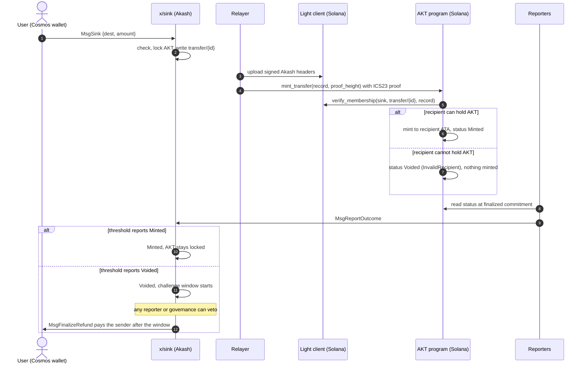

# AEP-95: One-Way AKT Sink to Solana

---
aep: 95
title: "One-Way AKT Sink to Solana"
author: Artur Troian (@troian), Joseph Chalabi (@chalabi2)
status: Draft
type: Standard
category: Core
created: 2026-10-27
discussions-to: https://github.com/orgs/akash-network/discussions
roadmap: major
requires: 79
---

## Summary

This AEP defines a one-way sink (bridge) for moving AKT from Akash to Solana, the first step in the Akash chain's migration (see [AEP-79](https://github.com/akash-network/aep/tree/main/spec/aep-79) and its Chain Migration Program document set).

1. The user signs `MsgSink` on Akash with an amount and a Solana wallet address.
2. A new module, `x/sink`, locks the AKT and writes a fixed 77-byte transfer record into its store.
3. A relayer submits a proof of the record to the AKT program on Solana. An Akash light client on Solana verifies it against headers signed by Akash validators.
4. The AKT program mints the same amount of SPL AKT, once per record. If the recipient cannot hold AKT, it marks the record voided instead.
5. Reporters read the outcome on Solana and submit it to Akash. A confirmed mint closes the record. A confirmed void allows a refund after a challenge window.

The AKT mint is created on Solana with zero supply before the Akash upgrade. Transfers open after the upgrade and completion of the token and portal audits required by Akash governance proposal 346. Overclock Labs (OCL) then sends 1,000,000 AKT through the bridge to a Solana treasury vault to provide initial liquidity. Every AKT on Solana, including this seed deposit, is minted against a proven deposit and backed by AKT locked in `x/sink`.

During the launch phase, SPL AKT supports transfers and DEX liquidity only, with no staking or governance rights. Inflation and BME remain on Akash, and total supply follows Akash's schedule.

## Motivation

AKT launches on Solana before any protocol functions move there. The immediate goal is market access. Solana has the deepest DEX liquidity and widest wallet distribution for DePIN assets. AKT holders should be able to trade against SOL and USDC there without a wrapped-asset intermediary.

The bridge is deliberately one-way. SPL AKT is the canonical token on Solana, so no return path is needed. Omitting that path removes the largest class of bridge attacks. Locking AKT preserves Akash's supply accounting and allows refunds through ordinary bank transfers.

This AEP covers the launch phase only. Staking, governance, BME and emissions on Solana belong to a later AEP.

## Constraints and scope

The design must meet these requirements.

1. The AKT mint is created on Solana first. Users initiate transfers from Akash to Solana, with no return path. Transfers remain open for 2 years from token launch, as proposal 346 requires.
2. AKT moved to Solana is locked on Akash in a new module, `x/sink`. The marketplace escrow module is not reused.
3. The user signs one Akash transaction (Keplr or any Cosmos wallet) with an amount and a Solana address. The AKT is locked, the destination is checked on both chains, and the AKT is minted on Solana. If Solana cannot accept the transfer, the AKT goes back to the sender.
4. During the launch phase the Solana token has no protocol functions: no staking and no governance.
5. Solana mints nothing on its own. Every SPL AKT is minted against a proven `x/sink` record. Inflation and BME continue on Akash.
6. Initial liquidity comes from Akash: once transfers open, OCL sends 1,000,000 AKT through `x/sink` to the treasury vault.
7. No intermediary chains in the transfer path (no Cosmos Hub, Axelar or Wormhole Gateway routing).
8. Anyone can relay. The relayer, reporters and light client can each be replaced through configuration or governance.
9. Only liquid AKT can be deposited. Bonded and unbonding AKT must finish unbonding first. A separate upgrade will support moving staked AKT in one step, as proposal 346 describes.

Out of scope: emissions, staking or governance on Solana, the future of the Akash chain, and residual balances at any future shutdown.

## Terminology

| Term              | Meaning                                                                                                                                                                         |
| ----------------- | ------------------------------------------------------------------------------------------------------------------------------------------------------------------------------- |
| `x/sink`          | New Akash module. Accepts deposits, locks AKT, stores transfer records and void orders, counts reporter votes and pays refunds.                                                 |
| Transfer record   | The 77-byte value at `transfer/{id}` in the `sink` store. Written once at deposit and never changed.                                                                            |
| Void order        | The 9-byte value at `void/{id}`, written by governance. Proving it on Solana voids that transfer.                                                                               |
| AKT program       | The Solana program that holds the AKT mint authority. It mints only against proven transfer records.                                                                            |
| Light client      | A dedicated deployment of the ICS07 Tendermint client from `cosmos/ibc-contracts`. It stores verified Akash headers on Solana and checks ICS23 proofs against their app hashes. |
| Relayer           | Off-chain service that uploads Akash headers to the light client and submits proofs to the AKT program. It has no authority over funds. Anyone can run one.                     |
| Reporter          | Independent operator that reads transfer outcomes from its own Solana node and votes on Akash. Reporters cannot mint.                                                           |
| Transfer status   | A permanent Solana account for each record ID. The first successful mint or void sets it to `Minted` or `Voided`.                                                               |
| Seed deposit      | OCL's 1,000,000 AKT transfer to the treasury vault through `MsgSink` after transfers open. It provides initial liquidity and follows the same rules as any other transfer.      |
| Token launch      | The moment transfers open. Proposal 346 expects it 2 to 3 weeks after that proposal passes, once the token and portal audits are complete.                                      |
| Pause guardian    | A key on each chain that can pause operations but cannot resume them.                                                                                                           |
| Upgrade authority | The key that can replace a Solana program's code. In production, a time-locked multisig.                                                                                        |

## Trust model

**What each side checks**

| Direction                    | Checked on chain                                                                                                                                           | Trusted                                                                                            |
| ---------------------------- | ---------------------------------------------------------------------------------------------------------------------------------------------------------- | -------------------------------------------------------------------------------------------------- |
| Akash to Solana (mint, void) | An ICS23 proof that the record or void order is in Akash state, against the app hash of a header the light client verified with Akash validator signatures | Akash validators, the initial checkpoint, and the upgrade authorities of the three Solana programs |
| Solana to Akash (outcomes)   | Nothing. There is no Solana light client on Akash                                                                                                          | A reporter threshold above two thirds, with a challenge window and veto before any refund          |

To accept a header that skips heights, the light client requires signatures representing more than one third of the last trusted validator set's voting power and more than two thirds of the new set's voting power. Forging Akash state on Solana therefore requires more than one third of the stake trusted at the last update. That stake remains bonded and slashable during the trusting period. Two valid, conflicting headers freeze the client.

**What each party could do if compromised**

| Party                                                      | Worst case                                                                                                                   | Bound                                                                                                                                       |
| ---------------------------------------------------------- | ---------------------------------------------------------------------------------------------------------------------------- | ------------------------------------------------------------------------------------------------------------------------------------------- |
| Relayer                                                    | Delay mints and voids                                                                                                        | Anyone can relay. With open relaying any signer can update headers                                                                          |
| Reporter threshold                                         | Confirm a false void, refunding a minted transfer; or confirm a false mint, preventing a voided transfer from being refunded | Challenge window with a veto by any one reporter or by governance. Daily refund cap. Any conflicting vote holds the transfer for governance |
| Upgrade authority (AKT, ICS07 or access manager)           | Mint without limit, by replacing code or re-pinning to a client it controls                                                  | Time-locked multisig appointed by Akash governance. Monitors alert on every admin event. Pause guardians act without the time lock          |
| Akash validators with more than one third of trusted stake | Forge Akash state on Solana                                                                                                  | Per-transfer and daily mint caps. Guardian pause. Misbehaviour freezes the client                                                           |
| Akash governance                                           | Void and refund any transfer that has not been minted. Change parameters                                                     | A refund goes only to the original sender. Governance cannot move locked AKT anywhere else                                                  |

## Specification

### Overview



A cap, pause or light-client error leaves no status on Solana, so the relayer retries later. A timeout alone never triggers a refund.

### Akash: `x/sink` module

#### Store

| Key                                | Value                   | Written by                                            | Notes                                      |
| ---------------------------------- | ----------------------- | ----------------------------------------------------- | ------------------------------------------ |
| `transfer/{id}`                    | 77-byte record          | `MsgSink`                                             | Proven on Solana. Never changed or deleted |
| `void/{id}`                        | 9 bytes                 | `MsgRequestVoid`                                      | Proven on Solana                           |
| `settlement/{id}`                  | `Settlement` (protobuf) | Reporters and governance                              | Bookkeeping only, never proven             |
| `open/{id}` (8-byte big-endian ID) | `0x01`                  | Added at deposit, removed at the first mint or refund | Index behind `OpenTransfers`               |

`{id}` in `transfer/` and `void/` is the decimal ID with no leading zeros. IDs start at 1, increase by one and are never reused. The store name `sink` and these two keys are part of the proof format: changing them breaks every Solana proof. Parameters, totals and per-sender usage are stored under separate keys that Solana never reads.

**Transfer record.** 77 bytes, integers little-endian, no length prefixes.

| Offset | Length | Field                             |
| ------ | ------ | --------------------------------- |
| 0      | 1      | Version, `1`                      |
| 1      | 8      | Transfer ID                       |
| 9      | 20     | Sender address bytes (not bech32) |
| 29     | 32     | Solana recipient public key       |
| 61     | 8      | Amount in `uakt`, positive        |
| 69     | 8      | Akash block height of the deposit |

**Void order.** 9 bytes: version `1`, then the transfer ID as a little-endian u64.

**Proofs.** The proof path has two parts, the store name `sink` and the key. The proof is a protobuf `ibc.core.commitment.v1.MerkleProof` (IAVL proof, then multistore proof), fetched with the ABCI query `/store/sink/key` and `prove=true`. State committed at height H is proven against the app hash in header H+1.

#### Deposit: `MsgSink`

`MsgSink { sender, dest_type, dest, amount }` returns `MsgSinkResponse { id }`.

A deposit must meet all of these conditions. Otherwise, the transaction fails without locking funds.

- `params.enabled` is true.
- `MsgSink` is the only top-level message in the transaction, and `sender` is an ordinary signing account. Module accounts, authz `MsgExec` and other nested execution are rejected.
- `dest_type` is `1` (Solana public key).
- `dest` is canonical base58 of 32 bytes and not all zeros. It must be a valid Ed25519 point (a wallet address) unless it is in `vault_allowlist`.
- `amount` is positive, in `uakt`, at least `min_transfer`, and no greater than either `solana_daily_mint_cap` or `max_transfer`. Each sender is limited to `max_daily_per_account` deposits per UTC day and `max_pending_per_account` open transfers.
- If `max_daily_amount_per_account` is set, the sender's total for the UTC day, including this deposit, stays within it.

On success, the module moves `amount` from the sender to the sink account, assigns the next ID, writes `transfer/{id}`, starts a pending settlement, adds the open-index entry and emits `sink_deposit`. The response includes the transfer ID.

The sink account is a blocked bank address. `MsgSend`, `MsgMultiSend` and contract sends to it fail, and it cannot be a distribution withdraw address. The memo is ignored. The user pays only the normal Akash transaction fee.

#### Settlement

Each transfer has a settlement status and a hold field.

| Status   | Meaning                                                                | Terminal |
| -------- | ---------------------------------------------------------------------- | -------- |
| Pending  | Deposited, no outcome confirmed                                        | No       |
| Minted   | Reporters confirmed the Solana mint. The AKT stays locked              | Yes      |
| Voided   | A Solana void was confirmed. The refund waits for the challenge window | No       |
| Refunded | The AKT was returned to the sender                                     | Yes      |

| Hold     | Set when                                                  | Cleared by |
| -------- | --------------------------------------------------------- | ---------- |
| None     | Normal state                                              |            |
| Veto     | A reporter or governance vetoes a voided transfer         | Governance |
| Conflict | Votes disagree, or a vote contradicts a confirmed outcome | Governance |

**Reporter votes.** `MsgReportOutcome { reporter, id, reporter_epoch, round, observation }`. The observation contains the outcome (minted or voided), the finalized Solana slot and the 64-byte transaction signature.

- The reporter must be in `params.reporters`, and the vote must specify the current reporter epoch and the transfer's current round. Duplicate votes have no effect.
- When `reporter_threshold` votes report a mint and there is no hold, the transfer becomes Minted (`sink_mint_confirmed`).
- When `reporter_threshold` votes report a void and there is no hold, the transfer becomes Voided and its challenge window ends `challenge_period_seconds` later (`sink_void_confirmed`).
- Mixed mint and void votes, or a vote against a confirmed outcome, set a conflict hold (`sink_conflict`).
- Changing the reporter set or the threshold increases `reporter_epoch`. Votes from older epochs do not count. On the next report, a nonterminal transfer returns to pending for a new vote.

**Refund.** `MsgFinalizeRefund { executor, id }`. Anyone can submit it. A refund is paid only when:

- `refunds_enabled` is true,
- the transfer is Voided with no hold,
- the void was confirmed in the current reporter epoch,
- the challenge window has ended,
- the amount fits within the remaining `daily_refund_cap` for the UTC day, and
- it is the oldest waiting refund, ordered by challenge end and then ID. `MsgFinalizeRefund` rejects all others.

It pays exactly the recorded amount to the recorded sender, marks the transfer Refunded and emits `sink_refunded`. The refund comes from that transfer's locked AKT.

**Veto.** `MsgVetoVoid { signer, id, reason }`. A current reporter can veto during the challenge window. Governance can veto any time before payment. The transfer must be Voided. The veto sets a hold (`sink_veto`).

**Governance.**

- `MsgRequestVoid { authority, id }` writes `void/{id}` for a transfer that is not Minted or Refunded (`sink_void_order`). It moves no funds. A refund still requires proof of the void on Solana and confirmation by reporters.
- `MsgResolveTransfer { authority, id, decision, observation, reason }` resolves a hold or stalled vote. `RESTART` returns the transfer to pending. `CONFIRM_MINT` and `CONFIRM_VOID` require a matching observation. `CONFIRM_VOID` starts a new challenge window and leaves any refund subject to the refund switch and cap. A Minted or Refunded transfer cannot change. Every decision starts a new round and clears the votes and the hold (`sink_resolved`).
- `MsgUpdateParams { authority, params }` replaces the whole parameter set. It is the only way to turn deposits or refunds on, or to set the guardian.

**Pause guardian.** `MsgGuardianPause { guardian, deposits, refunds }`. The signer must be `params.pause_guardian`. It turns `enabled`, `refunds_enabled` or both off, never on (`sink_guardian_pause`).

#### Messages

| Message              | Signer                 | Effect                                        |
| -------------------- | ---------------------- | --------------------------------------------- |
| `MsgSink`            | Depositor              | Lock AKT and write a transfer record          |
| `MsgReportOutcome`   | Reporter               | Vote on a transfer's Solana outcome           |
| `MsgVetoVoid`        | Reporter or governance | Hold a voided transfer before refund          |
| `MsgFinalizeRefund`  | Anyone                 | Pay an eligible refund to the original sender |
| `MsgGuardianPause`   | Pause guardian         | Turn off deposits, refunds or both            |
| `MsgRequestVoid`     | Governance             | Write a void order                            |
| `MsgResolveTransfer` | Governance             | Restart, confirm a mint, or confirm a void    |
| `MsgUpdateParams`    | Governance             | Replace parameters                            |

All eight messages have Amino JSON names, such as `sink/MsgSink` and `sink/MsgGuardianPause`, so Ledger signing works through Keplr.

#### Parameters

| Parameter                      | Unit         | Default        | Rule                                                                       |
| ------------------------------ | ------------ | -------------- | -------------------------------------------------------------------------- |
| `enabled`                      | bool         | false          | Needs reporters and `min_transfer` to be set                               |
| `solana_daily_mint_cap`        | uakt         | 10,000,000 AKT | Copy of the Solana daily cap. At least `max_transfer`                      |
| `min_transfer`                 | uakt         | 0 (off)        | Must be set before deposits are enabled. At most `max_transfer`            |
| `max_transfer`                 | uakt         | 1,000,000 AKT  | Positive and at most `solana_daily_mint_cap`                               |
| `max_daily_per_account`        | count        | 20             | Deposits one sender can make per UTC day. Positive                         |
| `max_pending_per_account`      | count        | 3              | Open transfers one sender can have at once. Positive                       |
| `max_daily_amount_per_account` | uakt         | 0 (no limit)   | AKT one sender can deposit per UTC day. If set, at least `min_transfer`    |
| `vault_allowlist`              | 32-byte keys | empty          | At most 16. Must match the Solana list                                     |
| `reporters`                    | addresses    | empty          | At most 32                                                                 |
| `reporter_threshold`           | count        | 0              | More than two thirds of `reporters`                                        |
| `challenge_period_seconds`     | seconds      | 259,200        | At least 259,200 (72 hours). Release builds reject anything shorter        |
| `daily_refund_cap`             | uakt         | 1,000,000 AKT  | At least `max_transfer`. Cannot be lowered below the largest open transfer |
| `refunds_enabled`              | bool         | false          |                                                                            |
| `pause_guardian`               | address      | empty          | A 20- or 32-byte account, such as a multisig or group policy               |

See Decisions for proposed mainnet values.

#### Queries

| Query           | REST                                                | Returns                                                                    |
| --------------- | --------------------------------------------------- | -------------------------------------------------------------------------- |
| `Sink`          | `/akash/sink/v1/records/{id}`                       | Public status and the transfer                                             |
| `State`         | `/akash/sink/v1/state`                              | Parameters and totals                                                      |
| `Transfer`      | `/akash/sink/v1/transfers/{id}`                     | Record, void-order flag and settlement                                     |
| `Account`       | `/akash/sink/v1/accounts/{sender}`                  | The sender's daily and pending usage                                       |
| `OpenTransfers` | `/akash/sink/v1/open_transfers?start_after=&limit=` | Transfers that are not Minted or Refunded, in ID order, up to 500 per page |

Public statuses are `transfer_pending`, `completed` (mint confirmed) and `void` (void confirmed or refunded). A void order alone does not show as `void`.

#### Events

| Event                      | When                                                       |
| -------------------------- | ---------------------------------------------------------- |
| `sink_deposit`             | A deposit is accepted                                      |
| `sink_void_order`          | Governance writes a void order                             |
| `sink_report`              | A reporter votes                                           |
| `sink_mint_confirmed`      | Mint votes reach the threshold                             |
| `sink_void_confirmed`      | Void votes reach the threshold (carries the challenge end) |
| `sink_conflict`            | Votes disagree                                             |
| `sink_veto`                | A void is vetoed                                           |
| `sink_resolved`            | Governance resolves a transfer                             |
| `sink_refunded`            | A refund is paid                                           |
| `sink_guardian_pause`      | The guardian switches something off                        |
| `sink_preexisting_balance` | The upgrade found a balance at the sink address            |

#### Totals and invariant

`Totals` tracks `pending_amount`, `minted_amount`, `voided_amount`, `refunded_amount`, `pending_count`, `last_transfer_id`, the day's refunds and `reporter_epoch`. Each transfer's amount belongs to exactly one total: pending, minted, voided or refunded. The module maintains this equality:

```
sink bank balance = pending_amount + minted_amount + voided_amount
```

`refunded_amount` is the cumulative amount paid out of the module. Only `MsgFinalizeRefund` can release locked AKT; there is no general withdrawal mechanism.

#### Upgrade and genesis

`GenesisState { params, totals, transfers, accounts }`.

The upgrade that adds the module must:

1. Add the store with `StoreUpgrades{Added: ["sink"]}`.
2. Before migrations, run `PrepareInstall`. The sink address is deterministic, so anyone can send coins to it before the upgrade. `PrepareInstall` converts any existing account at that address into the module account, preserves its account number, and moves its balance to the community pool (`sink_preexisting_balance`).
3. Run `InitGenesis` with default parameters and empty totals. No funds move.
4. Leave deposits and refunds disabled, with no reporters or guardian. Governance configures them after the upgrade.

Exported genesis keeps the records, settlements, counters and per-sender usage. Import checks the bank equality above.

### Solana: light client

The bridge uses a dedicated deployment of the ICS07 Tendermint client and its access manager, built from `cosmos/ibc-contracts` at `dc78ade828b766b218fb6bcb5417fdaf8e553021` with four patches:

| Patch                   | Change                                                                                                                                                      |
| ----------------------- | ----------------------------------------------------------------------------------------------------------------------------------------------------------- |
| Signature batches       | Ed25519 signatures are checked with Solana's Ed25519 precompile and stored as compact receipts, so a commit from a large validator set fits Solana's limits |
| Monotonic latest height | Accepting an older header no longer lowers the latest height, as in ibc-go                                                                                  |
| Consensus pruning       | `prune_consensus_state` closes expired consensus states and returns their rent. Requires an explicitly assigned `RELAYER_ROLE` member                       |
| Open relaying           | Granting `RELAYER_ROLE` to the ICS07 program's own ID lets any signer submit headers and misbehaviour                                                       |

- One client per deployment, at the `["client"]` PDA. Each verified height has a consensus state at `["consensus_state", height]` with its app hash and timestamp.
- Client settings: chain ID `akashnet-2`, trust level 1/3, trusting period at most 1,209,600 s (14 days, two thirds of the 21-day unbonding), unbonding 1,814,400 s, maximum clock drift measured before launch.
- The initial checkpoint is chosen in a ceremony: at least three people fetch a post-upgrade header, commit and validator set from at least three independent nodes and compare the block hash, app hash and validator hash.
- The client expires if no header is verified within the trusting period, and freezes on misbehaviour. A frozen or expired client cannot be recovered. The AKT program re-pins to a new deployment instead.
- The access manager's `RELAYER_ROLE` controls header uploads, updates, misbehaviour and pruning. With open relaying, anyone can do all of these except pruning.
- A full commit from 100 validators fits in one Solana transaction's compute limit. One from 129 does not. For sets with more than 100 signatures, the relayer submits only enough signatures for a quorum and marks the rest absent. This supports sets of at least 150 validators.

### Solana: AKT program

Anchor 0.32.1, legacy SPL Token.

#### Accounts

| Account          | Seeds                         | Contents                                                                                     |
| ---------------- | ----------------------------- | -------------------------------------------------------------------------------------------- |
| `LaunchConfig`   | `["config"]`                  | The `bridge_enabled` switch                                                                  |
| AKT mint         | `["mint"]`                    | Legacy SPL mint, 6 decimals                                                                  |
| Mint authority   | `["mint_authority"]`          | PDA that signs mints and metadata updates. Holds no data                                     |
| `BridgeConfig`   | `["bridge"]`                  | Pinned light-client program and chain ID, mint policy, minted amount for the current UTC day |
| `PauseGuardian`  | `["guardian"]`                | Guardian key                                                                                 |
| `ProofBuffer`    | `["proof", submitter, nonce]` | Up to 4,096 bytes of proof, uploaded in chunks                                               |
| `TransferStatus` | `["transfer", id as u64 LE]`  | Permanent `Minted` or `Voided` for one record ID                                             |

The mint policy has `per_transfer_max`, `daily_mint_cap` and up to 16 `vaults`, with `0 < per_transfer_max <= daily_mint_cap`.

#### Instructions

| Instruction                                                 | Caller                       | Effect                                                                                                          |
| ----------------------------------------------------------- | ---------------------------- | --------------------------------------------------------------------------------------------------------------- |
| `initialize`                                                | Upgrade authority, once      | Creates the zero-supply mint and configuration, with minting disabled                                           |
| `set_token_metadata`                                        | Upgrade authority            | Creates or updates the Metaplex name, symbol and URI                                                            |
| `configure_bridge(chain_id, policy)`                        | Upgrade authority, once      | Pins the light client and chain ID after checking the client is active. Minting stays off                       |
| `set_bridge_enabled(enabled)`                               | Upgrade authority            | Turns minting on or off                                                                                         |
| `set_mint_policy(policy)`                                   | Upgrade authority            | Replaces the caps and vault list. Preserves the day's usage                                                     |
| `set_pause_guardian(key or none)`                           | Upgrade authority            | Sets, rotates or clears the guardian                                                                            |
| `guardian_pause`                                            | Pause guardian               | Turns minting off. It can never turn it on                                                                      |
| `repin_light_client(chain_id)`                              | Upgrade authority, any time  | Pins another active ICS07 deployment without reading the old client, so a broken client cannot block the change |
| `create_proof_buffer`, `append_proof`, `close_proof_buffer` | Anyone, for their own buffer | Upload a proof in chunks and reclaim the rent afterwards                                                        |
| `mint_transfer(record, proof_height)`                       | Anyone                       | Proves `transfer/{id}`, then mints or voids                                                                     |
| `void_transfer(id, proof_height)`                           | Anyone                       | Proves `void/{id}`, then voids                                                                                  |

**`mint_transfer`**

1. It must be a top-level instruction, and only ComputeBudget instructions may come before it in the transaction. This keeps the `TransferResolved` event visible to reporters. Minting must be enabled.
2. It checks that the pinned light client uses the expected program and PDAs, matches the chain ID, and is not frozen. The latest consensus state must be within the trusting period, with a timestamp no later than the clock plus the allowed drift. `proof_height` must have a stored consensus state at or below the latest height, and the record's height must be between 1 and `proof_height`.
3. It builds the path `["sink", "transfer/{id}"]` and the 77-byte value from the record, and calls `verify_membership` on the pinned client with the uploaded proof.
4. It checks the recipient. A nonzero on-curve key owned by the System Program passes, whether or not the account exists. So does a key in `vaults`. Executables, token-program accounts, the zero key and the mint-authority PDA never pass, even if listed. A recipient whose existing AKT token account has been reassigned to another owner does not pass.
5. If the recipient fails, it writes `Voided / InvalidRecipient`. Nothing is minted and no token account is created.
6. If the recipient passes, it checks `amount <= per_transfer_max` and that the day's total stays within `daily_mint_cap`, creates the recipient's associated token account if needed, mints `amount` and writes `Minted`.
7. It emits `TransferResolved { id, proof_height, outcome }`.

If a cap, pause, light-client error or invalid proof causes the transaction to fail, nothing is written and the record can be retried.

**`void_transfer`** proves `void/{id}` equals `[1, id]` with the same light-client checks and writes `Voided / Governance`. It works while minting is paused and fails if the record already has a status.

Mint and void create the same `TransferStatus` account, so each record ID is resolved once: minted or voided, never both. A status cannot be closed or reset, including through re-pinning.

**Daily cap.** Days are fixed UTC days on the Solana clock, not a rolling 24 hours, so up to twice the cap can mint within 24 hours around midnight. Vault recipients are subject to the same caps. This is the per-epoch mint cap in proposal 346, with the UTC day as the epoch.

#### Events

| Event                 | Emitted by                       | Fields                                 |
| --------------------- | -------------------------------- | -------------------------------------- |
| `TokenMetadataSet`    | `set_token_metadata`             | mint, metadata account, URI            |
| `BridgeConfigured`    | `configure_bridge`               | light-client program, chain ID, policy |
| `BridgeEnabledSet`    | `set_bridge_enabled`             | enabled, signer                        |
| `MintPolicySet`       | `set_mint_policy`                | old and new policy                     |
| `PauseGuardianSet`    | `set_pause_guardian`             | old and new guardian                   |
| `GuardianPaused`      | `guardian_pause`                 | guardian                               |
| `LightClientRepinned` | `repin_light_client`             | old and new program and chain ID       |
| `TransferResolved`    | `mint_transfer`, `void_transfer` | record ID, proof height, outcome       |

A multisig calls the admin instructions through CPI, so monitors must read events by invocation frame. Anchor's TypeScript `EventParser` skips events logged inside a CPI.

#### Errors

AKT errors are 7000 to 7024. ICS07 errors start at 6000 and appear on the same instruction when a membership check fails, so the two ranges never overlap.

| Code | Name                      | Code | Name                        |
| ---- | ------------------------- | ---- | --------------------------- |
| 7000 | `InvalidProgramData`      | 7013 | `InvalidConsensusTimestamp` |
| 7001 | `UnauthorizedInitializer` | 7014 | `InvalidProofHeight`        |
| 7002 | `InvalidAuthority`        | 7015 | `InvalidProofLength`        |
| 7003 | `UnauthorizedGuardian`    | 7016 | `InvalidProofOffset`        |
| 7004 | Reserved (unused)         | 7017 | `IncompleteProof`           |
| 7005 | `InvalidMetadataUri`      | 7018 | `BridgeDisabled`            |
| 7006 | `InvalidMetadata`         | 7019 | `CpiNotAllowed`             |
| 7007 | `InvalidChainId`          | 7020 | `PrecedingInstruction`      |
| 7008 | `InvalidPolicy`           | 7021 | `InvalidRecord`             |
| 7009 | `InvalidLightClient`      | 7022 | `InvalidClock`              |
| 7010 | `WrongChain`              | 7023 | `TransferLimit`             |
| 7011 | `ClientFrozen`            | 7024 | `DailyLimit`                |
| 7012 | `ClientExpired`           |      |                             |

#### Authorities

| Power                                                                  | Holder in production                                                                               |
| ---------------------------------------------------------------------- | -------------------------------------------------------------------------------------------------- |
| Upgrade authority of the AKT, ICS07 and access-manager programs        | One time-locked multisig. All three are the same security tier: any of them can mint without limit |
| Access-manager admin (grants `RELAYER_ROLE`, opens or closes relaying) | The same multisig                                                                                  |
| Solana pause guardian                                                  | An on-call key outside the time lock, also held by the monitor for the automatic pause             |
| `x/sink` pause guardian                                                | An on-call key, multisig or group policy chosen by governance                                      |
| Treasury                                                               | A multisig vault                                                                                   |
| Metadata update authority                                              | The mint-authority PDA, changed only through `set_token_metadata`                                  |

The upgrade authorities are retained because `repin_light_client` and verifier fixes require them.

### Transfer caps

The following limits apply to transfer amounts and counts across both chains. Raise caps on Solana first; lower them on Akash first. See "Changing caps" under Launch sequence.

| Cap                         | Chain  | Parameter                      | Default             | Rule                                                                                       |
| --------------------------- | ------ | ------------------------------ | ------------------- | ------------------------------------------------------------------------------------------ |
| Minimum transfer            | Akash  | `min_transfer`                 | 0 (off)             | Must be set before deposits are enabled. At most `max_transfer`                            |
| Per-transfer maximum        | Akash  | `max_transfer`                 | 1,000,000 AKT       | Positive and at most `solana_daily_mint_cap`. No higher than the Solana `per_transfer_max` |
| Per-transfer maximum        | Solana | `per_transfer_max`             | Set by the multisig | Positive and at most `daily_mint_cap`                                                      |
| Daily mint cap              | Solana | `daily_mint_cap`               | Set by the multisig | At least `per_transfer_max`. Counted per fixed UTC day                                     |
| Copy of the daily mint cap  | Akash  | `solana_daily_mint_cap`        | 10,000,000 AKT      | Equal to the Solana `daily_mint_cap`. At least `max_transfer`                              |
| Deposits per sender per day | Akash  | `max_daily_per_account`        | 20                  | Positive                                                                                   |
| Open transfers per sender   | Akash  | `max_pending_per_account`      | 3                   | Positive                                                                                   |
| AKT per sender per day      | Akash  | `max_daily_amount_per_account` | 0 (no limit)        | If set, at least `min_transfer`                                                            |
| Daily refund cap            | Akash  | `daily_refund_cap`             | 1,000,000 AKT       | At least `max_transfer`. Cannot be lowered below the largest open transfer                 |

### Token

| Setting          | Value                                                                                                            | Reason                                                                                                   |
| ---------------- | ---------------------------------------------------------------------------------------------------------------- | -------------------------------------------------------------------------------------------------------- |
| Token program    | SPL Token (legacy)                                                                                               | Compatible with pools, aggregators, exchange deposit flows and older wallets                             |
| Decimals         | 6                                                                                                                | Matches `uakt`, so one unit on Akash is one unit on Solana                                               |
| Freeze authority | None, set at creation                                                                                            | Nobody can freeze holders' tokens. Freezable mints are flagged by aggregators and rejected by some pools |
| Mint authority   | The AKT program's `["mint_authority"]` PDA                                                                       | Only proven transfers can create tokens                                                                  |
| Metadata         | Metaplex: name "Akash Network", symbol AKT, HTTPS URI of at most 200 bytes, mutable through `set_token_metadata` | Wallets and explorers show it as AKT                                                                     |
| Initial supply   | None. OCL's 1,000,000 AKT seed deposit to the treasury vault is the initial liquidity                            | Every token on Solana is minted against a proven deposit                                                 |

The mint address is published on akash.network, the GitHub org, and to Jupiter, CoinGecko, CoinMarketCap, Solscan and SolanaFM before the seed deposit is minted. Assume impostor AKT mints already exist.

**SPL Token or Token-2022**

Solana has two token programs. SPL Token ("legacy") has a fixed feature set (mint, transfer, burn, approve, freeze) and keeps name and logo in a separate Metaplex account. Every wallet, DEX, aggregator, custodian, exchange and indexer on Solana supports it.

Token-2022 is a separate program with optional extensions fixed at mint creation: transfer fees, transfer hooks, confidential transfers, a permanent delegate, non-transferable tokens, default-frozen accounts and embedded metadata. Each integrator must add support for it separately.

| Consideration                                  | SPL Token     | Token-2022                                                                                                                      |
| ---------------------------------------------- | ------------- | ------------------------------------------------------------------------------------------------------------------------------- |
| Support                                        | Universal     | Most large venues and wallets. Uneven across exchange deposit flows, custodians, older indexers, hardware wallets and tax tools |
| Features this design needs                     | All           | All, plus extensions it does not use                                                                                            |
| Extensions that get a mint excluded from pools | None possible | Transfer hook, transfer fee, permanent delegate, default-frozen, non-transferable                                               |
| Can it be changed later                        | No            | No. Switching means another token swap                                                                                          |

Legacy SPL Token supports broad trading access on Solana and provides every feature this design needs. The choice is permanent. RENDER also uses legacy SPL Token. Token-2022 accounts cannot receive AKT from the bridge.

### Off-chain services

These services have no authority over funds. Each is configured with endpoints and keys, and each can be run by multiple operators.

| Service  | Does                                                                                                                                                                                                                                                                                                                                               | Needs                                                                                                                                                                                     |
| -------- | -------------------------------------------------------------------------------------------------------------------------------------------------------------------------------------------------------------------------------------------------------------------------------------------------------------------------------------------------- | ----------------------------------------------------------------------------------------------------------------------------------------------------------------------------------------- |
| Relayer  | Keeps the light client updated (on demand, and after one fifth of the trusting period when idle), fetches ICS23 proofs, uploads them and calls `mint_transfer` or `void_transfer` for waiting records in ID order. Checks Akash before spending SOL to avoid minting a record already voided or refunded on Akash. Prunes expired consensus states | An Akash node that keeps at least one trusting period of state, a Solana RPC, and a funded payer key. Reads the pinned light client from the `["bridge"]` account, so it follows a re-pin |
| Reporter | Reads `TransferStatus` and `TransferResolved` at finalized commitment from its own Solana node, checks program, amount and recipient, sends `MsgReportOutcome`, vetoes voids that do not match Solana, and sends `MsgFinalizeRefund` when one is due                                                                                               | Its own Solana node (no third-party RPC), its own Akash node, its own key in a KMS or HSM (external signer supported)                                                                     |
| Monitor  | Supply reconciliation with an automatic pause on any mismatch, light-client age, pending age, admin events, cap usage, fee balances                                                                                                                                                                                                                | Read access to both chains, and the Solana pause guardian key for the automatic pause                                                                                                     |
| Portal   | Connects the user's Keplr and Solana wallets and fills in the destination, so the address does not have to be typed by hand. Shows each transfer's status                                                                                                                                                                                          | Public Akash and Solana endpoints                                                                                                                                                         |

Costs: users pay the Akash transaction fee. Relayers pay Solana fees and rent: about 0.0035 SOL per mint, including the recipient's token account and the status account; refundable proof-buffer rent; and about 0.0015 SOL per verified header until it is pruned. `min_transfer` should be well above the relayer's cost.

### Failure handling

| Failure                                                                    | Where             | Result                                                                                                                           |
| -------------------------------------------------------------------------- | ----------------- | -------------------------------------------------------------------------------------------------------------------------------- |
| Bad amount, over a limit, deposits off, malformed or off-curve destination | Akash transaction | Fails. Nothing is locked                                                                                                         |
| Recipient is a token account, program, unlisted PDA or reassigned ATA      | `mint_transfer`   | `Voided / InvalidRecipient`, then refund                                                                                         |
| Governance void order                                                      | `void_transfer`   | `Voided / Governance`, then refund                                                                                               |
| Per-transfer maximum or daily cap reached                                  | `mint_transfer`   | Retry later                                                                                                                      |
| Minting paused                                                             | `mint_transfer`   | Retry later. Governance voids still work                                                                                         |
| Light client expired or frozen                                             | Solana            | Retry after a re-pin                                                                                                             |
| No relayer running                                                         | Off-chain         | Delay. Anyone can relay                                                                                                          |
| Reporters below threshold                                                  | Akash             | Transfer stays pending on Akash. Minted tokens are not affected, but the transfer still counts toward the sender's pending limit |
| Conflicting votes or a veto                                                | Akash             | Hold until governance resolves                                                                                                   |
| Refunds off or daily refund cap reached                                    | Akash             | Refund waits                                                                                                                     |

**Stuck transfers.** A transfer that cannot be minted, for example because its amount is above a lowered Solana cap, is resolved in this order:

1. Governance passes `MsgRequestVoid { id }`.
2. Anyone proves the void order with `void_transfer`. If the transfer was already minted, this fails and reporters confirm the mint instead.
3. Reporters confirm the void, the challenge window passes, and `MsgFinalizeRefund` pays the sender.

The order is enforced by the protocol. Akash refunds only after reporters observe a permanent `Voided` status on Solana, and after that status exists the record can never be minted.

**Guarantees**

- Each record ID is resolved at most once on Solana: one mint or one void.
- A mint is always exactly the recorded amount to the recorded recipient.
- Akash refunds only a transfer confirmed as voided, only to its original sender, only once, and only after the challenge window.
- Locked AKT leaves `x/sink` only through `MsgFinalizeRefund`.

### Supply accounting

Locking does not change Akash total supply, which stays the single source of truth.

```
Solana supply + SPL AKT burned on Solana = amounts of all Minted statuses on Solana
AKT locked behind those Minted records = Solana supply + SPL AKT burned on Solana
```

Mint confirmations reach Akash a few minutes after minting. The monitor therefore compares Akash records directly with Solana statuses without waiting for `minted_amount`. Any mismatch or violation of the `x/sink` bank equality triggers an alert and an immediate pause of Solana minting through the pause guardian key, as proposal 346 requires. The monitor also pages the on-call team, which can pause deposits on Akash.

| Figure             | Definition                                                                         |
| ------------------ | ---------------------------------------------------------------------------------- |
| Total supply       | Akash total supply                                                                 |
| Circulating supply | Akash circulating supply, minus the `x/sink` balance, plus Solana supply           |
| Supply on Solana   | Solana mint supply, which equals the locked AKT behind minted records, minus burns |

Before the first mint, Solana supply is zero. AKT burned on Solana stays locked on Akash. A public endpoint publishes these figures so CoinGecko, CoinMarketCap and exchanges report the same numbers.

### Launch sequence

**Solana (first)**

1. Generate fresh keypairs for the three programs and publish the reproducible build hashes.
2. Deploy with a one-time ceremony key. In one transaction, initialize the access manager, allow the multisig as its CPI caller, grant it admin and renounce the ceremony key's admin.
3. Run `initialize`. Check 6 decimals, no freeze authority, the PDA mint authority and zero supply.
4. Move all three upgrade authorities to the multisig and retire the ceremony key.
5. Through the multisig, set the token metadata and the pause guardian. Publish the mint address.

**Akash (later)**

6. Pass a software-upgrade proposal that specifies how to handle any balance already at the sink address. The upgrade adds `x/sink` and leaves deposits off. The upgrade takes no AKT from OCL; the seed follows as an ordinary deposit.
7. Conduct the checkpoint ceremony at a post-upgrade height. Through the multisig, in one transaction, initialize the ICS07 client and run `configure_bridge("akashnet-2", policy)` with a per-transfer maximum and daily cap of at least 1,000,000 AKT and the treasury vault in `vaults`. Start the relayer immediately because the trusting period begins at the checkpoint. Open relaying or grant relayer roles.
8. Reporters run in preview mode against their own nodes. After several days without issues and completion of the two independent token and portal audits required by proposal 346, pass a governance proposal to set the reporters, threshold, challenge period, vault list (including the treasury vault) and minimum transfer. It sets `max_transfer`, `solana_daily_mint_cap` and `daily_refund_cap` to at least 1,000,000 AKT and sets `enabled` to true. This opens transfers: the token launch in proposal 346.
9. Seed: OCL sends `MsgSink` for 1,000,000 AKT to the treasury vault. The multisig runs `set_bridge_enabled(true)` and the relayer mints it. The policy for other deposits while these higher caps apply remains open (see Decisions).
10. After the seed mints, lower the per-transfer and daily caps on both chains to their launch values, as in "Changing caps" below. Fund the counter-asset and seed the pools.
11. Run canary transfers: a normal transfer, an invalid recipient (void, then refund after the challenge window), and a transfer at the cap. Check supply after each. Then raise the daily cap in steps.

**Changing caps.** Raise the Solana caps first, then the Akash caps, keeping `daily_refund_cap` at least `max_transfer`. To reduce caps, lower them on Akash first. Wait until every transfer above the new Solana caps has minted or been refunded, then lower the Solana caps. `x/sink` refuses to lower `daily_refund_cap` below the largest open transfer, so every open transfer stays refundable.

### Initial liquidity

**AKT** OCL sends the 1,000,000 AKT seed through the bridge to the treasury vault once transfers open. Pools are seeded after it is minted, which requires the upgrade, audits and governance vote to be complete.

### Phase transition

The launch phase ends when a later AEP moves emissions to Solana.

- Akash: set inflation to zero and disable BME minting.
- Solana: emissions need a new mint path in the AKT program, added by a program upgrade through the multisig and time lock after Akash governance approves it. The proof-based mint stays for as long as deposits stay open.
- Before Akash stops running as a Cosmos chain, governance directs the multisig to transfer its authority to the successor or permanently disable minting if deposits end.

AKT remains locked. A later AEP will determine what happens to the locked AKT, the Akash chain and residual balances.

## Rationale

**A light client for minting.** Akash validators authorize mints, so there is no separate operator set to select, pay and rotate. Forging a mint requires more than a third of the trusted Akash stake. The ICS07 client from `cosmos/ibc-contracts` runs on Solana and verifies standard ICS23 proofs of any Akash store, so `x/sink` needs no IBC upgrade.

**Reporters for outcomes.** No Solana light client exists for Cosmos, so Akash cannot verify Solana state. Reporters can authorize refunds but cannot mint. Refunds are subject to the challenge window, veto and daily refund cap.

**Voids.** Solana cannot send Akash a verifiable message. A void is a permanent Solana status in the same account used to record a mint. A transfer therefore cannot have both outcomes. Akash refunds only after reporters observe that status. Once it exists, no one can mint the record, so a refund can never race a late mint. There is no refund on a timeout.

**Locking, not burning.** Burning would require minting refunds on Akash and would change Akash total supply with every transfer. Locking keeps Akash supply as the single source of truth, makes a refund a bank transfer, and leaves the fate of the locked AKT to governance.

**A dedicated module.** The marketplace escrow handles leases. The bridge requires immutable proof records, a void-order key, reporter voting and a refund path, which do not belong in the marketplace module.

**A dedicated deposit message.** Accepting plain sends to the module would mean handling every way funds can reach its address: IBC transfers, distribution withdrawals, authz and contracts. `MsgSink` is checked before fees are charged. The sink address remains blocked like other module accounts, and the memo is ignored.

**The seed goes through the bridge.** Every SPL AKT, including OCL's 1,000,000 AKT seed, is minted against a proven `x/sink` record, so all supply is backed by proven deposits and every mint is verified by the light client. This delays liquidity: pools can be seeded only after the upgrade, the light-client checkpoint and the seed mint.

**A daily cap, with per-transfer and per-sender limits.** The Solana per-transfer and daily caps bound what a forged header or a verifier bug could mint. `max_transfer` keeps every deposit within one day's mint cap and one day's refund cap. Per-sender limits slow floods of small deposits that cost the relayer rent. When set, the daily amount limit caps one sender's share of the daily cap. Absolute amounts in base units are simple to check on both chains. Fixed UTC days allow up to twice the cap within 24 hours around midnight; the design accepts this trade-off. A transfer waits until a UTC day has room for its whole amount. The relayer submits waiting records in ID order, so after each rollover the oldest is tried first. Anyone minting other records first can still delay it, and governance can void and refund a transfer that keeps waiting.

**Permissionless mint, void and relaying.** The system does not depend on a particular operator. Anyone with a valid proof can resolve a record, and open relaying allows any signer to keep the light client current. Re-pinning lets the program move to a light client run by others.

**Validation on Solana as well as on Akash.** Akash checks the address format and requires a wallet key or listed vault. Only Solana can see whether the destination is a token account, a program or a reassigned ATA, so the AKT program voids those and the sender gets a refund instead of losing the tokens.

**Legacy SPL over Token-2022.** See the Token section under Specification.

## Backward Compatibility

Existing modules, messages and state remain unchanged. `x/sink` is new and is installed in a chain upgrade that adds its store. Any existing account at the sink address is converted to the module account, and its balance goes to the community pool. Balances, delegations, vesting, IBC channels and marketplace escrow are untouched. No IBC upgrade is needed. Wallets need the Amino registration of `MsgSink` to sign with Ledger. Exchanges and data providers see a new non-circulating category (AKT locked in `x/sink`) and a new circulating venue (Solana).

## Test Cases

| Suite                                         | Covers                                                                                                                                                                                                                                                                                                                       |
| --------------------------------------------- | ---------------------------------------------------------------------------------------------------------------------------------------------------------------------------------------------------------------------------------------------------------------------------------------------------------------------------- |
| `x/sink` unit and keeper tests                | Deposit checks, record encoding, per-sender limits, parameter bounds between `min_transfer`, `max_transfer`, `solana_daily_mint_cap` and `daily_refund_cap`, settlement voting, epochs, holds, refunds, guardian, genesis import and export, bank equality                                                                   |
| Upgrade tests and old-to-new binary rehearsal | Store install, no AKT taken from OCL, dust and existing accounts at the sink address swept to the community pool                                                                                                                                                                                                             |
| AKT program unit tests                        | Wire format against a hand-written 77-byte vector, per-transfer and daily caps, policy rules, recipient rules, invocation rules                                                                                                                                                                                              |
| AKT program integration suite                 | Real patched ICS07 verifier and ICS23 proofs on a local validator: zero-supply initialize, mint, void, replay, caps, pause, guardian, re-pin, expiry, proof buffers, CPI rejection, interface stability                                                                                                                      |
| Real Akash state proof                        | A signed `MsgSink` in the real Akash app, proven on Solana                                                                                                                                                                                                                                                                   |
| Local stack                                   | Real CometBFT and Solana validators, signed header updates, the 1,000,000 AKT seed under raised caps and the cap lowering after it, mints, a cap-size mint after a UTC rollover, recipient voids, governance voids, challenge and refund, a cap-size refund, validator changes, 100-validator headers, misbehaviour freezing |
| Team testnet                                  | Long-running Akash testnet chain with the full off-chain stack and the reproducible program build                                                                                                                                                                                                                            |

Reproducible build hashes are published with the final release commit, not in this AEP.

## Security Considerations

| Threat                                    | Effect                                                                                                                                                               | Mitigation                                                                                                                                                                                                                                                                               |
| ----------------------------------------- | -------------------------------------------------------------------------------------------------------------------------------------------------------------------- | ---------------------------------------------------------------------------------------------------------------------------------------------------------------------------------------------------------------------------------------------------------------------------------------- |
| Forged Akash header                       | Unbacked mint on Solana                                                                                                                                              | Needs more than a third of trusted Akash stake. The per-transfer and daily caps bound the loss. Automatic guardian pause on a supply mismatch. Misbehaviour freezes the client                                                                                                           |
| Bad initial checkpoint                    | Light client trusts a false validator set                                                                                                                            | Checkpoint ceremony with independent people and nodes                                                                                                                                                                                                                                    |
| Light client expires                      | Mints and voids stop while deposits continue                                                                                                                         | Relayer refreshes at one fifth of the trusting period. Monitors warn at 25% and page at 50% of the period. `x/sink` guardian pauses deposits. Re-pin after a new ceremony                                                                                                                |
| Reporter threshold compromise, false void | Refund of a transfer that was minted (double spend). A record refunded without a Solana status could also be minted later by anyone                                  | Threshold above two thirds. Challenge window of at least 72 hours with a single-reporter or governance veto. Daily refund cap. The honest relayer checks Akash first, and the monitor alerts                                                                                             |
| Reporter threshold compromise, false mint | A voided transfer closes as Minted and the sender is never refunded. Supply is unaffected                                                                            | Threshold. Any honest conflicting vote holds the transfer for governance. Monitor compares outcomes with Solana statuses                                                                                                                                                                 |
| Reporter reads a fabricated Solana slot   | A veto is delayed by a few minutes                                                                                                                                   | Reporters reject slots beyond their own finalized slot plus a margin and look up signatures directly. Challenge period of at least 72 hours                                                                                                                                              |
| Wrong destination                         | Tokens minted to an unreachable account                                                                                                                              | Akash requires a wallet key or listed vault. Solana voids token accounts, programs, unlisted PDAs and reassigned ATAs. The portal fills in the address from a connected wallet. A valid key nobody holds cannot be detected                                                              |
| Replay                                    | Double mint or double refund                                                                                                                                         | One permanent status account per record ID. IDs are never reused. Akash refunds once and only from Voided. Never re-pin to a reset or forked chain that reuses IDs                                                                                                                       |
| Event hidden from reporters               | Transfer stays pending on Akash                                                                                                                                      | Mint and void reject CPI and allow only ComputeBudget instructions before them                                                                                                                                                                                                           |
| Rent griefing with tiny deposits          | Relayer spends SOL                                                                                                                                                   | `min_transfer`, the per-sender limits, and the relayer's spend ledger and per-transfer budget                                                                                                                                                                                            |
| Daily cap contention                      | A transfer needs room for its full amount within a day's cap, so a transfer near the cap may wait several days. The same applies to refunds under `daily_refund_cap` | Set the cap well above normal daily volume, and the per-transfer maximum well below it. The relayer submits in ID order. Monitors alert on pending age and above 80% cap usage. Raise the cap on both chains, Solana first. Governance can void and refund a transfer that keeps waiting |
| Large validator set                       | Header updates exceed compute                                                                                                                                        | Relayer submits only a quorum of signatures. Recheck before the active set grows past 100                                                                                                                                                                                                |
| Upgrade halts the chain                   | Unexpected account at the sink address                                                                                                                               | `PrepareInstall` adopts any account and moves its balance to the community pool                                                                                                                                                                                                          |
| Governance capture on Akash               | Hostile parameters or void orders                                                                                                                                    | A void refunds only the original sender and only if the transfer was not minted. Locked AKT cannot be sent anywhere else                                                                                                                                                                 |
| Impostor mints                            | Users buy the wrong token                                                                                                                                            | Canonical address published before the seed. Jupiter verification. Seeded pools on the canonical mint                                                                                                                                                                                    |

A compromised upgrade authority poses the greatest risk because it can mint without limit. A time-locked multisig holds that authority, monitors track its actions, and guardians can pause both chains without waiting for the time lock.

Two independent audits of the token and portal code must be completed before transfers open, as proposal 346 requires. Their reports must be published within 30 days.

## Operational considerations

**Wallets.** `MsgSink` is a normal Cosmos transaction, so Keplr, Leap and Ledger-backed accounts can sign it. Ledger signing uses its Amino registration. The portal connects the Solana wallet and uses its address as the destination. Manual address entry shows a warning because Solana addresses have no checksum. AKT on Osmosis or other IBC chains must return to Akash first. No SOL is needed to send a transfer.

**Exchanges.** Exchanges can move AKT from their Akash hot wallets to their Solana deposit addresses. SPL AKT deposits and withdrawals at exchanges close the arbitrage loop between exchanges and Solana DEXes. Exchange coordination begins before launch.

**Canonical address.** Before the seed deposit is minted, publish the mint address on akash.network and GitHub, obtain Jupiter verification, update the contract address on the existing CoinGecko and CoinMarketCap AKT pages, and claim the Solscan and SolanaFM pages. There is one official portal domain, announced through official Akash channels.

**Incentives.** None at launch. LP incentives are reviewed at 90 days.

**Operators.** Run at least one relayer; anyone can run additional relayers. Each reporter operates independently, using its own hosts, Akash and Solana nodes, and key. Alerts go to the on-call operator.

**Monitoring.** Track light-client age and frozen state, pending-transfer age, and transfers resolved on Solana but still pending on Akash. Monitor every void during its challenge window, reconcile supply, and check the bank equality. Track all authority and configuration changes on both chains, guardian and re-pin actions, relayer and reporter fee balances, reporter vote age, and cap usage above 80%.

**Runbooks.**

| Incident                           | First action                                                                                          | Follow-up                                                   |
| ---------------------------------- | ----------------------------------------------------------------------------------------------------- | ----------------------------------------------------------- |
| Suspected bad mint or verifier bug | Solana guardian pauses minting, automatically on a supply mismatch. `x/sink` guardian pauses deposits | Reconcile supply, then upgrade or re-pin                    |
| Suspicious void quorum             | Any honest reporter vetoes. If evidence cannot be checked, the `x/sink` guardian pauses refunds       | Governance resolves with `MsgResolveTransfer`               |
| Light client close to expiry       | Restart the relayer, switch RPC, check the payer balance                                              | Determine why updates stopped                               |
| Light client expired or frozen     | Pause deposits                                                                                        | New checkpoint ceremony, then re-pin                        |
| Relayer key leaked                 | Revoke its `RELAYER_ROLE`                                                                             | Loss is limited to its SOL balance. It cannot forge headers |
| Reporter key leaked                | Governance replaces the reporter. The new epoch prevents refunds based on older void confirmations    | Watch the other reporters' votes                            |
| Multisig member key leaked         | Rotate the member                                                                                     | Review pending multisig transactions                        |

## Decisions

**Decided**

| Item           | Decision                                                                                                                                                                                      |
| -------------- | --------------------------------------------------------------------------------------------------------------------------------------------------------------------------------------------- |
| Verification   | ICS07 Tendermint light client on Solana, pinned in the AKT program and replaceable with `repin_light_client`                                                                                  |
| Deposit format | Dedicated `MsgSink`. The sink is a blocked bank address                                                                                                                                       |
| Return path    | Permanent Solana voids observed by a reporter threshold, with a challenge window, veto and daily refund cap                                                                                   |
| Initial supply | None at token creation. Once transfers open, OCL sends 1,000,000 AKT with `MsgSink` to the treasury vault, under caps raised to at least that amount on both chains and lowered once it mints |
| Token program  | Legacy SPL Token, 6 decimals, no freeze authority, PDA mint authority                                                                                                                         |
| Caps           | A per-transfer maximum and a daily mint cap in base units on fixed UTC days, on both chains. On Akash, also per-sender daily and pending limits                                               |
| Pausing        | A pause-only guardian on each chain                                                                                                                                                           |
| Relaying       | Open to any signer through the open relaying patch. Mint and void are permissionless                                                                                                          |
| Fee grant      | None. Users pay the normal Akash fee                                                                                                                                                          |
| Incentives     | None at launch                                                                                                                                                                                |

**Open**

| Item                         | Proposal                                                                                                                                                                                                                                                                                        | Decided by                   |
|------------------------------|-------------------------------------------------------------------------------------------------------------------------------------------------------------------------------------------------------------------------------------------------------------------------------------------------|------------------------------|
| Seed window                  | During OCL's seed transfer, deposits are open to everyone with caps of at least 1,000,000 AKT on both chains. Choose whether the `x/sink` guardian pauses deposits immediately after the seed until a later proposal reopens them with low caps, or deposits remain open while caps are lowered | Akash governance             |
| Amino names                  | `sink/MsgSink` and `sink/MsgGuardianPause` differ from the `akash/...` style. Changing them changes sign bytes, so decide before the release                                                                                                                                                    | Akash maintainers            |
| Reporter set                 | At least 7 independent operators, threshold 5                                                                                                                                                                                                                                                   | Akash governance             |
| Challenge period             | At least 259,200 s (72 hours)                                                                                                                                                                                                                                                                   | Akash governance             |
| Light-client trusting period | At most 1,209,600 s (14 days)                                                                                                                                                                                                                                                                   | Multisig                     |
| Maximum clock drift          | Measure on mainnet first                                                                                                                                                                                                                                                                        | Multisig                     |
| Caps                         | Start low, except for the seed transfer, and raise after a period without issues. `max_transfer` at most the Solana `per_transfer_max`, `solana_daily_mint_cap` equal to the Solana daily cap, `daily_refund_cap` at least `max_transfer`                                                       | Akash governance, multisig   |
| Per-sender limits            | The defaults: 20 deposits a day and 3 open transfers per sender                                                                                                                                                                                                                                 | Akash governance             |
| Minimum transfer             | Well above the relayer's cost of about 0.0035 SOL per mint                                                                                                                                                                                                                                      | Akash governance             |
| Vault allowlist              | Reviewed vaults only, the same list on both chains                                                                                                                                                                                                                                              | Akash governance, multisig   |
| Pause guardians              | An on-call key on Solana, also held by the monitor for the automatic pause. An on-call key or group policy for `x/sink`                                                                                                                                                                         | Operations, Akash governance |
| Checkpoint ceremony          | Three people, three independent nodes, a post-upgrade height                                                                                                                                                                                                                                    | Launch team                  |
| Program keypairs             | Fresh keypairs for all three programs. Destroy the verifier's keypair after deployment because open relaying grants the role to its program ID                                                                                                                                                  | Launch team                  |
| Token metadata               | Name, symbol, logo and a public, versioned HTTPS URI                                                                                                                                                                                                                                            | Akash maintainers            |
| Audits                       | Two independent audits of the token and portal code, covering the mint logic, before transfers open, as proposal 346 requires. Reports published within 30 days                                                                                                                                 | OCL                          |

## References

- [AEP-79: Akash on Shared Security](https://github.com/akash-network/aep/tree/main/spec/aep-79) and its Chain Migration Program document set
- [Akash governance proposal 346: Migrate the Akash Protocol to Solana](https://www.mintscan.io/akash/proposals/346)
- [cosmos/ibc-contracts](https://github.com/cosmos/ibc-contracts), ICS07 Tendermint light client and access manager for Solana
- [ICS-23 commitment proofs](https://github.com/cosmos/ics23)
- Solana SPL Token and Token-2022 documentation, Metaplex Token Metadata, Squads multisig, Noble CCTP
- AKT on Solana: [Implementation Status](./implementation.md) (companion document)

## Copyright

All content is licensed under [Apache 2.0](https://www.apache.org/licenses/LICENSE-2.0).
