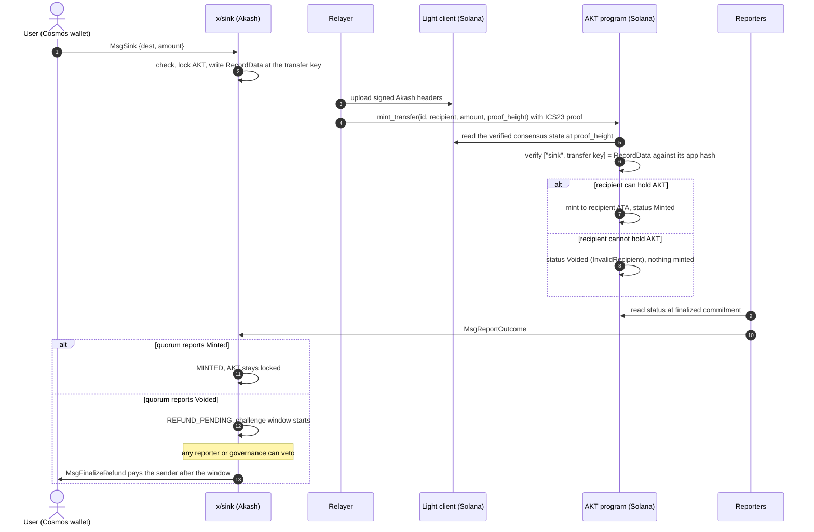

## Summary

This AEP defines a one-way sink (bridge) for moving AKT from Akash to Solana, the first step in the Akash chain's migration (see [AEP-79](https://github.com/akash-network/aep/tree/main/spec/aep-79) and its Chain Migration Program document set).

1. The user signs `MsgSink` on Akash with an amount and a Solana wallet address.
2. A new module, `x/sink`, locks the AKT and writes an immutable transfer record into its store.
3. A relayer submits a proof of the record to the AKT program on Solana. The program checks the proof against the app hash of an Akash header that an Akash light client on Solana verified with validator signatures.
4. The AKT program mints the same amount of SPL AKT, once per record. If the recipient cannot hold AKT, it marks the record voided instead.
5. Reporters read the outcome on Solana and submit it to Akash. A confirmed mint closes the record. A confirmed void allows a refund after a challenge window.

The Akash upgrade comes first and installs `x/sink` with deposits and refunds disabled. The AKT mint is created on Solana with zero supply after the upgrade and before transfers open. Transfers open at the token launch, once the token and portal audits required by Akash governance proposal 346 are complete. The launch is coordinated with the Akash parameter proposal that enables `x/sink`. Overclock Labs (OCL) then sends 1,000,000 AKT through the bridge to a Solana treasury vault to provide initial liquidity. Every AKT on Solana, including this seed deposit, is minted against a proven deposit and backed by AKT locked in `x/sink`.

During the launch phase, SPL AKT supports transfers and DEX liquidity only, with no staking or governance rights. Inflation and BME remain on Akash, and total supply follows Akash's schedule.

## Motivation

AKT launches on Solana before any protocol functions move there. The immediate goal is market access. Solana has the deepest DEX liquidity and widest wallet distribution for DePIN assets. AKT holders should be able to trade against SOL and USDC there without a wrapped-asset intermediary.

The bridge is deliberately one-way. SPL AKT is the canonical token on Solana, so no return path is needed. Omitting that path removes the largest class of bridge attacks. Locking AKT preserves Akash's supply accounting and allows refunds through ordinary bank transfers.

This AEP covers the launch phase only. Staking, governance, BME and emissions on Solana belong to a later AEP.

## Constraints and scope

The design must meet these requirements.

1. The AKT mint exists on Solana before any transfer can be made, and Akash locks nothing until the parameter proposal that enables `x/sink` passes. Users initiate transfers from Akash to Solana, with no return path. Transfers remain open for 2 years from token launch, as proposal 346 requires. This is a governance commitment; nothing on chain enforces it.
2. AKT moved to Solana is locked on Akash in a new module, `x/sink`. The marketplace escrow module is not reused.
3. The user signs one Akash transaction (Keplr or any Cosmos wallet) with an amount and a Solana address. The AKT is locked, the destination is checked on both chains, and the AKT is minted on Solana. If Solana cannot accept the transfer, the AKT goes back to the sender.
4. During the launch phase the Solana token has no protocol functions: no staking and no governance.
5. Solana mints nothing on its own. Every SPL AKT is minted against a proven `x/sink` record. Inflation and BME continue on Akash.
6. Initial liquidity comes from Akash: once transfers open, OCL sends 1,000,000 AKT through `x/sink` to the treasury vault.
7. No intermediary chains in the transfer path (no Cosmos Hub, Axelar or Wormhole Gateway routing).
8. Anyone can relay. The relayer, reporters and light client can each be replaced through configuration or governance.
9. Only liquid AKT can be deposited. Bonded and unbonding AKT must finish unbonding first. A separate upgrade will support moving staked AKT in one step, as proposal 346 describes.

Out of scope: emissions, staking or governance on Solana, the future of the Akash chain, and residual balances at any future shutdown.

## Terminology

| Term              | Meaning                                                                                                                                                                                                                                                         |
| ----------------- | --------------------------------------------------------------------------------------------------------------------------------------------------------------------------------------------------------------------------------------------------------------- |
| `x/sink`          | New Akash module. Accepts deposits, locks AKT, stores transfer records and settlements, counts reporter votes and pays refunds.                                                                                                                                 |
| Transfer ID       | `owner/height/sequence`: the depositor's account, the block height of the deposit and a sequence that starts at 1 in every block. Never reused.                                                                                                                 |
| Transfer record   | The protobuf `RecordData` (recipient and amount) at the transfer's key in the `sink` store. Written once at deposit and never changed.                                                                                                                          |
| Settlement        | The protobuf `SettlementData` of a transfer: hold, round, reporter policy, votes, challenge end, governance evidence, veto and void order. Its key carries the transfer's settlement status.                                                                    |
| Void order        | The permanent `void_authorization` that governance writes into a settlement. Proving that settlement on Solana voids the transfer.                                                                                                                              |
| Reporter policy   | An immutable, versioned reporter set with a threshold ratio. Each settlement records the policy its votes count under.                                                                                                                                          |
| Quota epoch       | The current epoch of the existing `x/epochs` schedule named `day`. The Akash deposit and refund caps are counted per quota epoch.                                                                                                                               |
| AKT program       | The Solana program that holds the AKT mint authority. It mints only against proven transfer records.                                                                                                                                                            |
| Light client      | A dedicated deployment of the ICS07 Tendermint client from `akash-network/ibc-contracts`. It stores verified Akash headers on Solana. The AKT program checks ICS23 proofs against their app hashes.                                                             |
| Relayer           | Off-chain service that uploads Akash headers to the light client and submits proofs to the AKT program. It has no authority over funds. Anyone can run one.                                                                                                     |
| Reporter          | Independent operator that reads transfer outcomes from its own Solana node and votes on Akash. Reporters cannot mint.                                                                                                                                           |
| Transfer status   | A permanent Solana account for each transfer ID. The first successful mint or void sets it to `Minted` or `Voided`.                                                                                                                                             |
| Seed deposit      | OCL's 1,000,000 AKT transfer to the treasury vault through `MsgSink` after transfers open. It provides initial liquidity and follows the same rules as any other transfer.                                                                                      |
| Token launch      | The moment transfers open: the single Akash parameter proposal that enables `x/sink` passes, and the multisig turns on Solana minting right after. Proposal 346 expects the launch 2 to 3 weeks after it passes, once the token and portal audits are complete. |
| Seed window       | From the token launch until the caps on both chains are lowered to their launch values after the seed deposit mints. Both chains use caps of at least 1,000,000 AKT during it.                                                                                  |
| Pause guardian    | A key on each chain that can pause operations but cannot resume them.                                                                                                                                                                                           |
| Upgrade authority | The key that can replace a Solana program's code. In production, a time-locked multisig.                                                                                                                                                                        |

## Trust model

**What each side checks**

| Direction                    | Checked on chain                                                                                                                                                                              | Trusted                                                                                                               |
| ---------------------------- | --------------------------------------------------------------------------------------------------------------------------------------------------------------------------------------------- | --------------------------------------------------------------------------------------------------------------------- |
| Akash to Solana (mint, void) | An ICS23 proof that the transfer record, or a settlement carrying a void order, is in Akash state, against the app hash of a header the light client verified with Akash validator signatures | Akash validators, the initial checkpoint, and the upgrade authorities of the three Solana programs                    |
| Solana to Akash (outcomes)   | Nothing. There is no Solana light client on Akash                                                                                                                                             | A reporter quorum above two thirds of the current reporter policy, with a challenge window and veto before any refund |

To accept a header that skips heights, the light client requires signatures representing more than one third of the last trusted validator set's voting power and more than two thirds of the new set's voting power. Forging Akash state on Solana therefore requires more than one third of the stake trusted at the last update. That stake remains bonded and slashable during the trusting period. Two valid, conflicting headers freeze the client.

**What each party could do if compromised**

| Party                                                      | Worst case                                                                                                                   | Bound                                                                                                                                                       |
| ---------------------------------------------------------- | ---------------------------------------------------------------------------------------------------------------------------- | ----------------------------------------------------------------------------------------------------------------------------------------------------------- |
| Relayer                                                    | Delay mints and voids                                                                                                        | Anyone can relay. With open relaying any signer can update headers                                                                                          |
| Reporter quorum                                            | Confirm a false void, refunding a minted transfer; or confirm a false mint, preventing a voided transfer from being refunded | Challenge window with a veto by any one reporter or by governance. Refund cap per quota epoch. Any conflicting vote holds the transfer for governance       |
| Upgrade authority (AKT, ICS07 or access manager)           | Mint without limit, by replacing code or re-pinning to a client it controls                                                  | Time-locked multisig appointed by Akash governance. Monitors alert on every admin event. Pause guardians act without the time lock                          |
| Akash validators with more than one third of trusted stake | Forge Akash state on Solana                                                                                                  | Per-transfer and daily mint caps. Guardian pause. Misbehaviour freezes the client                                                                           |
| Akash governance                                           | Void and refund any transfer that is not Minted or Refunded. Change parameters                                               | A refund goes only to the original sender. A Minted transfer is final: governance cannot void or refund it. Governance cannot move locked AKT anywhere else |

## Specification

### Overview



A cap, pause or light-client error leaves no status on Solana, so the relayer retries later. A timeout alone never triggers a refund.

### Akash: `x/sink` module

#### Store

| Key                                | Value                                                                                                                 | Written by                                          | Notes                                                                                   |
| ---------------------------------- | --------------------------------------------------------------------------------------------------------------------- | --------------------------------------------------- | --------------------------------------------------------------------------------------- |
| `0x02 0x00` ‖ transfer ID          | `RecordData` (protobuf)                                                                                               | `MsgSink`                                           | Proven on Solana by `mint_transfer`. Never changed or deleted                           |
| `0x03 0x01` ‖ status ‖ transfer ID | `SettlementData` (protobuf)                                                                                           | Deposits, reporters, vetoes, governance and refunds | Exactly one per transfer, under its current status. Proven on Solana by `void_transfer` |
| Other prefixes                     | Parameters, totals, account and epoch usage, reporter policies, the refund queue, and the history and dispute indexes | The module                                          | Never proven                                                                            |

**Transfer ID.** `owner/height/sequence`. The owner is the depositor's account address, the height is the block height of the deposit, and the sequence starts at 1 in every block and increases by one for each deposit in that block. No two transfers share a height and sequence, and IDs are never reused. In keys, an ID is `u8(len(owner)) ‖ owner ‖ BE64(height) ‖ BE64(sequence)`. A 20-byte owner gives 39-byte transfer keys and 40-byte settlement keys.

**Transfer record.** `RecordData { dest, amount }`. Field 1 is the canonical base58 recipient. Field 2 is the `uakt` Coin, with denom `uakt` and the amount as a decimal string. The value is `0x0a len(dest) dest 0x12 (8 + len(amount)) 0x0a 0x04 "uakt" 0x12 len(amount) amount`, 45 to 76 bytes. The sender, height and sequence are in the key, not the value.

**Settlement.** `SettlementData` holds, in field order: hold, round, the embedded reporter policy, votes, challenge end, governance observation, veto signer, veto reason, void order (field 9: `requested_height`, `requested_round`) and veto policy version. The settlement status is part of the key only. A void order, once written, survives every later change to the settlement.

**Proofs.** The proof path has two parts, the store name `sink` and the key. The proof is a protobuf `ibc.core.commitment.v1.MerkleProof` (IAVL proof, then multistore proof), fetched with the ABCI query `/store/sink/key` and `prove=true`. State committed at height H is proven against the app hash in header H+1, so a proof height is always above the deposit height. The store name, both key layouts and both value encodings are part of the proof format: changing any of them breaks every Solana proof. [Implementation](./implementation.md) gives the byte-level layouts.

#### Deposit: `MsgSink`

`MsgSink { sender, dest_type, dest, amount }` returns `MsgSinkResponse { id }`, the transfer ID.

A deposit must meet all of these conditions. Otherwise, the transaction fails without locking funds.

- `params.enabled` is true and the current reporter policy has members.
- `MsgSink` is the only top-level message in the transaction, and `sender` is an ordinary signing account with a public key. Module accounts, authz `MsgExec` and other nested execution are rejected.
- `dest_type` is `1` (Solana public key).
- `dest` is canonical base58 of 32 bytes, at most 44 characters and not all zeros. Unless it is in `allowed_destination_vaults`, it must be the canonical encoding of an Ed25519 point that is not of small order (a wallet address).
- `amount` is positive, in `uakt`, fits a u64, and is at least `min_amount_per_transfer` and at most `max_amount_per_transfer`.
- The quota epoch has started. Including this deposit, the sender's deposits in the epoch stay within `max_epoch_amount_per_account` when it is set, and all deposits in the epoch stay within `max_transfer_amount_per_epoch`.

The format checks (sender address, `dest_type`, destination encoding, and a positive `uakt` amount that fits a u64) and the single-message check run before the fee is charged. The other checks run when the message executes, after the fee is charged.

On success, the module moves `amount` from the sender to the sink account, assigns the ID, writes the record and a `TRANSFER_PENDING` settlement under the current reporter policy, adds the amount to the sender's and the epoch's usage, and emits `EventTransferCreated`. The response includes the transfer ID.

The sink account is a blocked bank address. `MsgSend`, `MsgMultiSend` and contract sends to it fail, and it cannot be a distribution withdraw address. The memo is ignored. The user pays only the normal Akash transaction fee.

**Quota epoch.** The Akash caps count usage in the current epoch of the `x/epochs` schedule named `day`. Its duration and start come from the epochs state (24 hours in the default genesis), and its boundaries need not fall at 00:00 UTC. An epoch advances in the first block after it ends; after downtime the counter advances by one epoch per block. Usage restarts at zero in each epoch, and unused allowance does not carry over. Refunds do not restore deposit capacity. Deposits and refund payments fail until epoch counting has started.

#### Settlement

Each transfer has one settlement with a status, a hold and a round. The round starts at 1. Reporter votes name it, and each governance resolution starts the next one.

| Status             | Meaning                                                                                                                        | Terminal |
| ------------------ | ------------------------------------------------------------------------------------------------------------------------------ | -------- |
| `TRANSFER_PENDING` | Deposited, no outcome confirmed, no void order                                                                                 | No       |
| `MINTED`           | The Solana mint was confirmed. The AKT stays locked                                                                            | Yes      |
| `VOIDED`           | Governance ordered a void. No Solana void is confirmed and no refund is authorized                                             | No       |
| `REFUND_PENDING`   | A Solana void was confirmed. The refund waits for the challenge window, the refund switch, the refund queue and the refund cap | No       |
| `REFUNDED`         | The AKT was returned to the sender                                                                                             | Yes      |

| Hold     | Set when                                                                                                      | Cleared by |
| -------- | ------------------------------------------------------------------------------------------------------------- | ---------- |
| None     | Normal state                                                                                                  |            |
| Veto     | A reporter or governance vetoes a `REFUND_PENDING` transfer                                                   | Governance |
| Conflict | A vote contradicts the counted outcome or governance evidence, including on a `MINTED` or `REFUNDED` transfer | Governance |

Holds do not change the status. A conflict hold takes precedence over a veto.

**Reporter policy.** A change to `reporters` or `reporters_threshold` creates a new immutable `ReporterPolicy { version, members, threshold }`. Reordering the members does not. The quorum is `ceil(threshold × members)` and must exceed two thirds of the members. Each settlement embeds the policy its votes count under, and each vote records its policy version.

**Reporter votes.** `MsgReportOutcome { reporter, id, policy_version, round, observation }`. The observation contains the outcome (minted or voided), the finalized Solana slot and the 64-byte transaction signature.

- The reporter must be a member of the current policy, and the vote must name the current policy version and the settlement's round. A repeated vote has no effect.
- The first vote sets the outcome being counted. When matching votes under the settlement's policy reach the quorum and there is no hold, the transfer becomes `MINTED` (`EventMintConfirmed`), or `REFUND_PENDING` with a challenge window that ends `reporter_challenge_period` later (`EventVoidConfirmed`). A `VOIDED` transfer can still become `MINTED`.
- A vote for the other outcome, or against governance evidence, is kept as the one opposing witness and sets a conflict hold (`EventReportConflict`). Reports on a conflict-held transfer have no effect.
- Once the quorum is reached, or while a hold is set, further matching votes have no effect.
- After a policy change, votes under older versions do not count. The next current-policy report on an unheld transfer that is not `MINTED` or `REFUNDED` and has no governance evidence replaces its embedded policy, clears its votes and challenge window, and returns it to `TRANSFER_PENDING`, or to `VOIDED` if it has a void order.

**Refund.** `MsgFinalizeRefund { executor, id }`. Anyone can submit it. A refund is paid only when:

- `refunds_enabled` is true,
- the transfer is `REFUND_PENDING` with no hold,
- the void was confirmed by a quorum of the current reporter policy, or by governance, whose confirmation survives reporter changes,
- the challenge window has ended,
- it is the head of the refund queue, and
- the amount fits within the remaining `max_epoch_refund` for the quota epoch.

The refund queue holds the unheld `REFUND_PENDING` transfers, ordered by challenge end and then by transfer key. Its head is the earliest entry among governance-confirmed refunds and refunds confirmed under the current policy. Refunds confirmed under an older policy are not eligible and do not block the queue. `MsgFinalizeRefund` rejects every transfer except the head.

It pays exactly the recorded amount to the recorded sender, marks the transfer `REFUNDED` and emits `EventTransferRefunded`. The refund comes from that transfer's locked AKT. Repeating it for a refunded transfer has no effect.

**Veto.** `MsgVetoVoid { signer, id, reason }`. A member of the current reporter policy can veto before the challenge window ends. Governance can veto any time before payment. The transfer must be `REFUND_PENDING`. The veto sets a veto hold, unless a conflict hold is set, and records the signer and reason (`EventVoidVetoed`).

**Governance.** `MINTED` and `REFUNDED` are final. Governance can void and refund only a transfer that is not `MINTED` or `REFUNDED`, and no governance confirmation changes the status of a `MINTED` transfer. Every `reason` below, and the veto reason above, is 1 to 256 bytes of UTF-8.

- `MsgRequestVoid { authority, id, expected_round }` writes a void order (the request height and round) into the settlement of a transfer that is not `MINTED` or `REFUNDED`, and moves a `TRANSFER_PENDING` transfer to `VOIDED` (`EventVoidOrdered`). `expected_round` must equal the settlement's round. Repeating it for a transfer that already has a void order has no effect. It moves no funds. A refund still requires proof of the void on Solana and its confirmation.
- `MsgRestartTransfer { authority, id, reason, expected_round }` returns a transfer that is not `MINTED` or `REFUNDED` to `TRANSFER_PENDING`, or to `VOIDED` if it has a void order.
- `MsgConfirmMint { authority, id, evidence, reason, expected_round }` records the Solana mint (`evidence` is the slot and the 64-byte transaction signature) and sets the transfer `MINTED`. It cannot change a `REFUNDED` transfer. On a `MINTED` transfer it only records the evidence and clears the hold.
- `MsgConfirmVoid { authority, id, evidence, reason, expected_round }` records the Solana void for a transfer that has a void order and is neither `MINTED` nor `REFUNDED`, and sets it `REFUND_PENDING` with a new challenge window. The amount must fit within `max_epoch_refund`. On a `REFUNDED` transfer it only records the evidence and clears the hold; it pays nothing.
- Each of these three resolutions requires `expected_round` to equal the settlement's round. It starts a new round, embeds the current reporter policy, and clears the votes, the hold and any veto (`EventTransferResolved`).
- `MsgUpdateParams { authority, params }` replaces the whole parameter set. It is the only way to turn deposits or refunds on, or to set the guardian. Changing a cap keeps the usage already counted in the epoch.

**Pause guardian.** `MsgGuardianPause { guardian, deposits, refunds }`. The signer must be `params.pause_guardian`. It turns `enabled`, `refunds_enabled` or both off, never on (`EventGuardianPaused`). At least one of them must be selected.

#### Messages

| Message              | Signer                 | Effect                                                        |
| -------------------- | ---------------------- | ------------------------------------------------------------- |
| `MsgSink`            | Depositor              | Lock AKT and write a transfer record                          |
| `MsgReportOutcome`   | Reporter               | Vote on a transfer's Solana outcome                           |
| `MsgVetoVoid`        | Reporter or governance | Hold a confirmed void before refund                           |
| `MsgFinalizeRefund`  | Anyone                 | Pay an eligible refund to the original sender                 |
| `MsgGuardianPause`   | Pause guardian         | Turn off deposits, refunds or both                            |
| `MsgRequestVoid`     | Governance             | Write a void order                                            |
| `MsgRestartTransfer` | Governance             | Restart the vote on a transfer that is not Minted or Refunded |
| `MsgConfirmMint`     | Governance             | Confirm a mint with Solana evidence                           |
| `MsgConfirmVoid`     | Governance             | Confirm a void with Solana evidence                           |
| `MsgUpdateParams`    | Governance             | Replace parameters                                            |

All ten messages have Amino JSON names made of `sink/` and the message name, such as `sink/MsgSink` and `sink/MsgGuardianPause`, so Ledger signing works through Keplr.

#### Parameters

| Parameter                       | Unit        | Default        | Rule                                                                                                                                                                               |
| ------------------------------- | ----------- | -------------- | ---------------------------------------------------------------------------------------------------------------------------------------------------------------------------------- |
| `enabled`                       | bool        | false          | Needs reporters and a positive `min_amount_per_transfer`                                                                                                                           |
| `min_amount_per_transfer`       | uakt        | 1 AKT          | Positive while deposits are enabled. At most `max_amount_per_transfer` and `max_transfer_amount_per_epoch`, and at most `max_epoch_amount_per_account` when that is set            |
| `max_amount_per_transfer`       | uakt        | 1,000,000 AKT  | Positive, fits a u64, at most `max_epoch_refund`                                                                                                                                   |
| `max_transfer_amount_per_epoch` | uakt        | 10,000,000 AKT | Positive. All deposits in one quota epoch. An Akash cap, not a copy of the Solana daily cap                                                                                        |
| `max_epoch_amount_per_account`  | uakt        | 1,000,000 AKT  | 0 means no limit. One sender's deposits in one quota epoch                                                                                                                         |
| `max_epoch_refund`              | uakt        | 1,000,000 AKT  | Positive, at least `max_amount_per_transfer`. Refunds paid in one quota epoch. Cannot be lowered below the amount of any `TRANSFER_PENDING`, `VOIDED` or `REFUND_PENDING` transfer |
| `reporters`                     | addresses   | empty          | Distinct accounts, none of them a module account. Bounded by the Solana proof limit (below)                                                                                        |
| `reporters_threshold`           | ratio       | 0.66           | From 0 to 1. With reporters, `ceil(ratio × reporters)` must exceed two thirds of them                                                                                              |
| `reporter_challenge_period`     | duration    | 72 hours       | At least 72 hours; release builds reject anything shorter. At most 9,223,372,035.999999999 s, the Amino JSON limit                                                                 |
| `allowed_destination_vaults`    | base58 keys | empty          | Canonical and distinct. Exempt from the curve check only                                                                                                                           |
| `refunds_enabled`               | bool        | false          |                                                                                                                                                                                    |
| `pause_guardian`                | address     | empty          | Any account, such as a multisig or group policy                                                                                                                                    |

Amounts are `uakt` Coins. The quorum and module-account rules apply when `MsgUpdateParams` executes, not when the proposal is submitted, so a proposal that breaks them fails without changing state. A reporter address that has no account yet is allowed. Reporter messages are matched against the members as listed, so each reporter is listed in its canonical lowercase form. With the default ratio 0.66, the quorum is not above two thirds for any set whose size is divisible by three, so governance sets a ratio such as 0.67 together with the reporters.

**Reporter set size.** A governance void proves the whole `SettlementData` on Solana, including the embedded reporter policy and the votes. That value, with the rest of the IAVL and multistore proof, must fit the AKT program's 16,384-byte proof limit. Governance keeps the reporter set small enough that the largest settlement its policy allows (a full quorum of votes, one opposing witness, a veto with a 256-byte reason and a void order) still fits. Otherwise governance voids under that policy cannot be proven. The chain does not check this bound.

The amount defaults are the code's development values. The cap defaults meet the seed-window minimum but are not launch caps; see Transfer caps for the cap policy and Decisions for proposed mainnet values.

#### Queries

| Query       | REST                                                   | Returns                                                                                   |
| ----------- | ------------------------------------------------------ | ----------------------------------------------------------------------------------------- |
| `Transfer`  | `/akash/sink/v1/transfers/{owner}/{height}/{sequence}` | Record, settlement and status of one transfer                                             |
| `Transfers` | `/akash/sink/v1/transfers?owner=&status=`              | One owner's transfers, one status bucket, or the chronological history                    |
| `Disputes`  | `/akash/sink/v1/disputes`                              | Held transfers, including `MINTED` and `REFUNDED` ones, in chronological order            |
| `Account`   | `/akash/sink/v1/accounts/{owner}`                      | The owner's lifetime deposits and deposits in the current quota epoch                     |
| `State`     | `/akash/sink/v1/state`                                 | Totals, the quota epoch, deposit and refund usage in it, and the refund queue head        |
| `Params`    | `/akash/sink/v1/params`                                | Parameters                                                                                |
| `Reporters` | `/akash/sink/v1/reporters?version=`                    | Reporter policies: version 0 for the current one, the maximum u64 for all, or one version |

`Transfers` with an owner lists that owner's transfers by height and sequence. With a status it lists that status bucket in key order, within the owner when both are given. With neither it lists the chronological history, by height, sequence and owner. Its pagination keys are opaque cursors that carry the filter and the position: a resumed page takes the owner and status from the cursor and reads `reverse` from the request. A zero limit selects 100, and there is no maximum. Offsets require a status filter. `count_total` is ignored, and `total` is the size of the returned page. `Disputes` uses standard SDK pagination. Clients read every page of a scan at the same block height.

Status values are `TRANSFER_PENDING` (1), `MINTED` (2), `VOIDED` (3), `REFUND_PENDING` (4) and `REFUNDED` (5). Open transfers are those in `TRANSFER_PENDING`, `VOIDED` and `REFUND_PENDING`. A void order alone shows as `VOIDED`, which authorizes no refund.

#### Events

| Event                          | When                                                              |
| ------------------------------ | ----------------------------------------------------------------- |
| `EventTransferCreated`         | A deposit is accepted                                             |
| `EventVoidOrdered`             | Governance writes a void order                                    |
| `EventOutcomeReported`         | A reporter's vote is recorded                                     |
| `EventMintConfirmed`           | Mint votes reach the quorum                                       |
| `EventVoidConfirmed`           | Void votes reach the quorum (carries the challenge end)           |
| `EventReportConflict`          | A vote sets a conflict hold                                       |
| `EventVoidVetoed`              | A confirmed void is vetoed                                        |
| `EventTransferResolved`        | Governance restarts or confirms a transfer (carries the decision) |
| `EventTransferRefunded`        | A refund is paid                                                  |
| `EventGuardianPaused`          | The guardian switches something off                               |
| `EventPreexistingBalanceMoved` | The upgrade moved a balance found at the sink address             |
| `EventTotalsUpdated`           | A transfer is created or changes status (carries the totals)      |

All are typed `akash.sink.v1` protobuf events. The installation also emits an untyped `sink_withdraw_address_reset` event for each withdraw address it clears.

#### Totals and invariant

`Totals` holds an amount and a count for each status: `pending`, `minted`, `voided`, `refund_pending` and `refunded`. Each transfer belongs to exactly one of them, regardless of holds. The module maintains this equality, with no other denominations in its account:

```
sink bank balance = pending_amount + minted_amount + voided_amount + refund_pending_amount
```

The module checks the equality before and after every deposit and refund, at genesis import and export, and during the upgrade. `refunded_amount` is the cumulative amount paid out of the module. Only `MsgFinalizeRefund` can release locked AKT; there is no general withdrawal mechanism.

#### Upgrade and genesis

`GenesisState { params, totals, policy_sequence, policies, send_usage, refund_usage, records, accounts }`. Each record carries the transfer ID, the record, the settlement and the status. Each account entry carries one owner's usage.

The `v2.2.0` upgrade that adds the module must:

1. Refuse to run if `sink` is already in the module version map, and add the store with `StoreUpgrades{Added: ["sink"]}`.
2. Before migrations, run `PrepareInstall`. The sink address is deterministic, so anyone can send coins to it before the upgrade. `PrepareInstall` converts any existing account at that address into the module account, preserves its account number, moves its balance to the community pool (`EventPreexistingBalanceMoved`) and clears delegator withdraw addresses that point at it.
3. Run `InitGenesis` with the default genesis: default parameters, empty totals and no reporter policy. No funds move.
4. Check the bank equality, then set the default parameters again. This creates reporter policy version 1 with no members and ratio 0.66.
5. Leave deposits and refunds disabled, with no reporters or guardian. The governance proposal that opens transfers sets all of them (see Launch sequence).

Exported genesis keeps every record, settlement, reporter policy, usage counter and account entry. Import requires an empty store and checks the whole snapshot: valid parameters; unique reporter policies, none ahead of `policy_sequence`, with the policy at `policy_sequence` matching the parameters; every settlement against the policies it references; unique IDs and unique height and sequence pairs; totals recomputed from the records; lifetime usage equal to each owner's records, epoch usage that sums to the deposit usage, and refund usage within the refunded total; unpaid amounts within `max_epoch_refund`; usage epochs not ahead of the current quota epoch; governance vetoes signed by the governance account; deposit and void-request heights below the new chain's initial height; and the bank equality. A zero-height export is refused once any transfer exists, because transfer IDs keep their deposit heights.

### Solana: light client

The bridge uses a dedicated deployment of the ICS07 Tendermint client and its access manager, built from `akash-network/ibc-contracts` at `0da3165d8428a1b7792cc17551ecd1d3985761e6`. That revision carries four changes to the upstream client:

| Change                  | Effect                                                                                                                                                      |
| ----------------------- | ----------------------------------------------------------------------------------------------------------------------------------------------------------- |
| Signature batches       | Ed25519 signatures are checked with Solana's Ed25519 precompile and stored as compact receipts, so a commit from a large validator set fits Solana's limits |
| Monotonic latest height | Accepting an older header no longer lowers the latest height, as in ibc-go                                                                                  |
| Consensus pruning       | `prune_consensus_state` closes expired consensus states other than the latest and returns their rent. Requires an explicitly assigned `RELAYER_ROLE` member |
| Open relaying           | Granting `RELAYER_ROLE` to the ICS07 program's own ID lets any signer submit headers and misbehaviour                                                       |

The AKT program's membership library and the relayer's header encoder are pinned to the same revision.

- One client per deployment, at the `["client"]` PDA. Each verified height has a consensus state at `["consensus_state", height]`, with the height as a little-endian u64, holding its app hash and timestamp. The AKT program reads these accounts and verifies ICS23 proofs itself; it does not call the client's `verify_membership`.
- Client settings: chain ID `akashnet-2`, trust level 1/3, trusting period at most 1,209,600 s (14 days, two thirds of the 21-day unbonding), unbonding 1,814,400 s, maximum clock drift measured before launch. The AKT program accepts only a client whose trusting period is positive and shorter than its unbonding period.
- The initial checkpoint is chosen in a ceremony: at least three people fetch a post-upgrade header, commit and validator set from at least three independent nodes and compare the block hash, app hash and validator hash.
- The client expires if no header is verified within the trusting period, and freezes on misbehaviour. A frozen or expired client cannot be recovered. The AKT program re-pins to a new deployment instead.
- The access manager's `RELAYER_ROLE` controls header uploads, updates, misbehaviour and pruning. With open relaying, anyone can do all of these except pruning.
- A full commit from 100 validators fits in one Solana transaction's compute limit. One from 129 does not. For sets with more than 100 signatures, the relayer submits only enough signatures for a quorum and marks the rest absent. This supports sets of at least 150 validators. A header update accepts at most 256 pre-verified signatures.

### Solana: AKT program

Anchor 0.32.1, legacy SPL Token.

#### Accounts

| Account          | Seeds                                                                | Contents                                                                                                                     |
| ---------------- | -------------------------------------------------------------------- | ---------------------------------------------------------------------------------------------------------------------------- |
| `LaunchConfig`   | `["config"]`                                                         | The `bridge_enabled` switch and the mint                                                                                     |
| AKT mint         | `["mint"]`                                                           | Legacy SPL mint, 6 decimals                                                                                                  |
| Mint authority   | `["mint_authority"]`                                                 | PDA that signs mints and metadata updates. Holds no data                                                                     |
| `BridgeConfig`   | `["bridge"]`                                                         | Pinned light-client program and chain ID, mint policy, minted amount for the current UTC day                                 |
| `PauseGuardian`  | `["guardian"]`                                                       | Guardian key                                                                                                                 |
| `ProofBuffer`    | `["proof", submitter, SHA-256(proven key)]`                          | Up to 16,384 bytes of proof, uploaded in chunks of at most 500 bytes                                                         |
| `TransferStatus` | `["transfer", SHA-256(owner), height as u64 LE, sequence as u64 LE]` | Permanent outcome for one transfer ID: proof height, resolution slot, and the minted amount and recipient or the void reason |

The owner is hashed because an Akash address can be longer than Solana's 32-byte seed limit.

The mint policy has `per_transfer_max`, `daily_mint_cap` and up to 16 `vaults`, with `0 < per_transfer_max <= daily_mint_cap` and no zero key in `vaults`.

#### Instructions

| Instruction                                                                                                          | Caller                       | Effect                                                                                                           |
| -------------------------------------------------------------------------------------------------------------------- | ---------------------------- | ---------------------------------------------------------------------------------------------------------------- |
| `initialize`                                                                                                         | Upgrade authority, once      | Creates the zero-supply mint and configuration, with minting disabled                                            |
| `set_token_metadata(uri)`                                                                                            | Upgrade authority            | Creates or updates the Metaplex name, symbol and URI                                                             |
| `configure_bridge(chain_id, policy)`                                                                                 | Upgrade authority, once      | Pins the light client and chain ID after checking the client is active. Minting stays off                        |
| `set_bridge_enabled(enabled)`                                                                                        | Upgrade authority            | Turns minting on or off                                                                                          |
| `set_mint_policy(policy)`                                                                                            | Upgrade authority            | Replaces the caps and vault list. Preserves the day's usage                                                      |
| `set_pause_guardian(key or none)`                                                                                    | Upgrade authority            | Sets, rotates or clears the guardian                                                                             |
| `guardian_pause`                                                                                                     | Pause guardian               | Turns minting off. It can never turn it on                                                                       |
| `repin_light_client(chain_id)`                                                                                       | Upgrade authority, any time  | Pins another active ICS07 deployment without reading the old client, so a broken client cannot block the change  |
| `create_proof_buffer(nonce, expected_len)`, `grow_proof_buffer`, `append_proof(offset, chunk)`, `close_proof_buffer` | Anyone, for their own buffer | Upload a proof in chunks, grow the buffer past its first 10,240-byte allocation, and reclaim the rent afterwards |
| `mint_transfer(id, recipient_key, amount, proof_height)`                                                             | Anyone                       | Proves the transfer record, then mints or voids                                                                  |
| `void_transfer(id, settlement_status, proof_height)`                                                                 | Anyone                       | Proves the settlement's void order, then voids                                                                   |

`id` is the transfer ID: the owner's address bytes (1 to 255 bytes), the height and the sequence. Chain IDs are 1 to 64 bytes. A mint or void may use any submitter's complete proof buffer; the nonce and the proof bind its contents to the operation.

**`mint_transfer`**

1. It must be a top-level instruction, and only ComputeBudget instructions may come before it in the transaction. This keeps the `TransferResolved` event visible to reporters. Minting must be enabled.
2. It checks that the pinned light client uses the expected program and PDAs, matches the chain ID, is not frozen, and has a positive trusting period shorter than its unbonding period. The latest consensus state must be within the trusting period, with a nonzero timestamp no later than the clock plus the allowed drift. `proof_height` must have a stored consensus state at or below the latest height. The ID must have a nonempty owner and a positive height and sequence, and its height must be below `proof_height`.
3. It builds the transfer key from `id` and the `RecordData` value from `recipient_key` and `amount`. It requires a complete proof buffer whose nonce is the SHA-256 of that key, and verifies both proof levels of `["sink", key]` with that value against the consensus state's app hash.
4. It checks the recipient. A nonzero on-curve key owned by the System Program passes, whether or not the account exists. So does a key in `vaults`. Executables, accounts owned by either token program, the zero key and the mint-authority PDA never pass, even if listed. The recipient's associated token account must be absent or an initialized legacy SPL Token account for the AKT mint owned by the recipient, so a recipient whose token account has been reassigned to another owner does not pass.
5. If the recipient fails, it writes `Voided / InvalidRecipient`. Nothing is minted and no token account is created.
6. If the recipient passes, it checks `amount <= per_transfer_max` and that the day's total stays within `daily_mint_cap`, creates the recipient's associated token account if needed, mints `amount` and writes `Minted` with the amount and recipient.
7. It emits `TransferResolved { id, proof_height, resolved_at_slot, outcome }`.

If a cap, pause, light-client error or invalid proof causes the transaction to fail, nothing is written and the record can be retried.

**`void_transfer`** proves the settlement under the key whose status byte is `settlement_status` (1 to 5), with the same light-client and proof-buffer checks. The proven value must be a well-formed `SettlementData` with a void order whose request height is at least the deposit height and below `proof_height`, and whose request round is positive and at most the settlement's round. It writes `Voided / Governance`. It works while minting is paused and fails if the record already has a status.

Mint and void create the same `TransferStatus` account, so each transfer ID is resolved once: minted or voided, never both. A status cannot be closed or reset, including through re-pinning.

**Daily cap.** Days are fixed UTC days on the Solana clock, not a rolling 24 hours, so up to twice the cap can mint within 24 hours around midnight. Vault recipients are subject to the same caps. This is the per-epoch mint cap in proposal 346, with the UTC day as the epoch. It is independent of the Akash quota epoch.

#### Events

| Event                 | Emitted by                       | Fields                                              |
| --------------------- | -------------------------------- | --------------------------------------------------- |
| `LaunchInitialized`   | `initialize`                     | mint, initializer                                   |
| `TokenMetadataSet`    | `set_token_metadata`             | mint, metadata account, URI                         |
| `BridgeConfigured`    | `configure_bridge`               | light-client program, chain ID, policy              |
| `BridgeEnabledSet`    | `set_bridge_enabled`             | enabled, authority                                  |
| `MintPolicySet`       | `set_mint_policy`                | previous and new policy                             |
| `PauseGuardianSet`    | `set_pause_guardian`             | previous and new guardian                           |
| `GuardianPaused`      | `guardian_pause`                 | guardian                                            |
| `LightClientRepinned` | `repin_light_client`             | previous and new program and chain ID               |
| `TransferResolved`    | `mint_transfer`, `void_transfer` | transfer ID, proof height, resolution slot, outcome |

A multisig calls the admin instructions through CPI, so monitors must read events by invocation frame. Anchor's TypeScript `EventParser` skips events logged inside a CPI.

#### Errors

AKT errors are 7000 to 7028, numbered in order with no gaps. The program verifies membership itself, so a failed proof is `InvalidMembershipProof`, and ICS07 errors do not appear on a mint or void.

| Code | Name                        | Code | Name                       |
| ---- | --------------------------- | ---- | -------------------------- |
| 7000 | `InvalidProgramData`        | 7015 | `InvalidProofOffset`       |
| 7001 | `UnauthorizedInitializer`   | 7016 | `IncompleteProof`          |
| 7002 | `InvalidAuthority`          | 7017 | `BridgeDisabled`           |
| 7003 | `UnauthorizedGuardian`      | 7018 | `CpiNotAllowed`            |
| 7004 | `InvalidMetadataUri`        | 7019 | `PrecedingInstruction`     |
| 7005 | `InvalidMetadata`           | 7020 | `InvalidRecord`            |
| 7006 | `InvalidChainId`            | 7021 | `InvalidClock`             |
| 7007 | `InvalidPolicy`             | 7022 | `TransferLimit`            |
| 7008 | `InvalidLightClient`        | 7023 | `DailyLimit`               |
| 7009 | `WrongChain`                | 7024 | `InvalidProofNonce`        |
| 7010 | `ClientFrozen`              | 7025 | `InvalidSettlementStatus`  |
| 7011 | `ClientExpired`             | 7026 | `InvalidVoidAuthorization` |
| 7012 | `InvalidConsensusTimestamp` | 7027 | `InvalidMembershipProof`   |
| 7013 | `InvalidProofHeight`        | 7028 | `ProofBufferTooSmall`      |
| 7014 | `InvalidProofLength`        |      |                            |

#### Authorities

| Power                                                                  | Holder in production                                                                               |
| ---------------------------------------------------------------------- | -------------------------------------------------------------------------------------------------- |
| Upgrade authority of the AKT, ICS07 and access-manager programs        | One time-locked multisig. All three are the same security tier: any of them can mint without limit |
| Access-manager admin (grants `RELAYER_ROLE`, opens or closes relaying) | The same multisig                                                                                  |
| Solana pause guardian                                                  | An on-call key outside the time lock, also held by the monitor for the automatic pause             |
| `x/sink` pause guardian                                                | An on-call key, multisig or group policy chosen by governance                                      |
| Treasury                                                               | A multisig vault                                                                                   |
| Metadata update authority                                              | The mint-authority PDA, changed only through `set_token_metadata`                                  |

The upgrade authorities are retained because `repin_light_client` and verifier fixes require them.

### Transfer caps

The following limits apply to transfer amounts across both chains. Raise caps on Solana first; lower them on Akash first. See "Changing caps" under Launch sequence.

| Cap                      | Chain  | Parameter                       | Default             | Rule                                                                                    |
| ------------------------ | ------ | ------------------------------- | ------------------- | --------------------------------------------------------------------------------------- |
| Minimum transfer         | Akash  | `min_amount_per_transfer`       | 1 AKT               | Positive while deposits are enabled. At most `max_amount_per_transfer`                  |
| Per-transfer maximum     | Akash  | `max_amount_per_transfer`       | 1,000,000 AKT       | Positive. No higher than the Solana `per_transfer_max`                                  |
| Per-transfer maximum     | Solana | `per_transfer_max`              | Set by the multisig | Positive and at most `daily_mint_cap`                                                   |
| Daily mint cap           | Solana | `daily_mint_cap`                | Set by the multisig | At least `per_transfer_max`. Counted per fixed UTC day                                  |
| Deposits per epoch       | Akash  | `max_transfer_amount_per_epoch` | 10,000,000 AKT      | Positive. All deposits in one quota epoch. No higher than the Solana `daily_mint_cap`   |
| AKT per sender per epoch | Akash  | `max_epoch_amount_per_account`  | 1,000,000 AKT       | 0 means no limit. If set, at least `min_amount_per_transfer`                            |
| Refunds per epoch        | Akash  | `max_epoch_refund`              | 1,000,000 AKT       | At least `max_amount_per_transfer`. Cannot be lowered below the largest unpaid transfer |

The cross-chain rules are operational rules for governance and the multisig, and neither chain checks them: the Akash per-transfer maximum is no higher than the Solana `per_transfer_max`, the Akash deposit cap per epoch is no higher than the Solana `daily_mint_cap`, and `allowed_destination_vaults` and the Solana `vaults` list the same keys.

**Cap policy.** Caps start low, except for the seed transfer. During the seed window both chains use caps of at least 1,000,000 AKT, so the seed fits in one transfer. After the seed mints, governance and the multisig lower the caps to the launch values, as in "Changing caps", and raise them in steps after a period without issues. The Akash defaults above are development values: they meet the seed-window minimum but are not launch caps. The 1,000,000 AKT per transfer and 10,000,000 AKT per UTC day used by the deployment tooling and the launch rehearsal are also seed-window values, not launch caps.

### Token

| Setting          | Value                                                                                                                               | Reason                                                                                                   |
| ---------------- | ----------------------------------------------------------------------------------------------------------------------------------- | -------------------------------------------------------------------------------------------------------- |
| Token program    | SPL Token (legacy)                                                                                                                  | Compatible with pools, aggregators, exchange deposit flows and older wallets                             |
| Decimals         | 6                                                                                                                                   | Matches `uakt`, so one unit on Akash is one unit on Solana                                               |
| Freeze authority | None, set at creation                                                                                                               | Nobody can freeze holders' tokens. Freezable mints are flagged by aggregators and rejected by some pools |
| Mint authority   | The AKT program's `["mint_authority"]` PDA                                                                                          | Only proven transfers can create tokens                                                                  |
| Metadata         | Metaplex: name "Akash Network", symbol AKT, HTTPS URI of at most 200 bytes of printable ASCII, mutable through `set_token_metadata` | Wallets and explorers show it as AKT                                                                     |
| Initial supply   | None. OCL's 1,000,000 AKT seed deposit to the treasury vault is the initial liquidity                                               | Every token on Solana is minted against a proven deposit                                                 |

The mint address is published on akash.network, the GitHub org, and to Jupiter, CoinGecko, CoinMarketCap, Solscan and SolanaFM before the seed deposit is minted. Assume impostor AKT mints already exist.

**SPL Token or Token-2022**

Solana has two token programs. SPL Token ("legacy") has a fixed feature set (mint, transfer, burn, approve, freeze) and keeps name and logo in a separate Metaplex account. Every wallet, DEX, aggregator, custodian, exchange and indexer on Solana supports it.

Token-2022 is a separate program with optional extensions fixed at mint creation: transfer fees, transfer hooks, confidential transfers, a permanent delegate, non-transferable tokens, default-frozen accounts and embedded metadata. Each integrator must add support for it separately.

| Consideration                                  | SPL Token     | Token-2022                                                                                                                      |
| ---------------------------------------------- | ------------- | ------------------------------------------------------------------------------------------------------------------------------- |
| Support                                        | Universal     | Most large venues and wallets. Uneven across exchange deposit flows, custodians, older indexers, hardware wallets and tax tools |
| Features this design needs                     | All           | All, plus extensions it does not use                                                                                            |
| Extensions that get a mint excluded from pools | None possible | Transfer hook, transfer fee, permanent delegate, default-frozen, non-transferable                                               |
| Can it be changed later                        | No            | No. Switching means another token swap                                                                                          |

Legacy SPL Token supports broad trading access on Solana and provides every feature this design needs. The choice is permanent. RENDER also uses legacy SPL Token. Token-2022 accounts cannot receive AKT from the bridge.

### Off-chain services

These services have no authority over funds. Each is configured with endpoints and keys, and each can be run by multiple operators. [Implementation](./implementation.md) records which of these requirements the reference services meet.

| Service  | Does                                                                                                                                                                                                                                                                                                                                                                                                                                                                                                                                                             | Needs                                                                                                                                                                                     |
| -------- | ---------------------------------------------------------------------------------------------------------------------------------------------------------------------------------------------------------------------------------------------------------------------------------------------------------------------------------------------------------------------------------------------------------------------------------------------------------------------------------------------------------------------------------------------------------------- | ----------------------------------------------------------------------------------------------------------------------------------------------------------------------------------------- |
| Relayer  | Keeps the light client updated (on demand, and after one fifth of the trusting period when idle), fetches ICS23 proofs, uploads them and calls `mint_transfer` or `void_transfer`, submitting waiting records oldest first: by deposit height, then sequence. Checks Akash before spending SOL and again before resolving: a record with a void order is proven as a void, and a record that Akash shows as `REFUND_PENDING` or `REFUNDED` without a void order is never minted. Prunes expired consensus states. Keeps a spend ledger and a per-transfer budget | An Akash node that keeps at least one trusting period of state, a Solana RPC, and a funded payer key. Reads the pinned light client from the `["bridge"]` account, so it follows a re-pin |
| Reporter | Reads `TransferStatus` and `TransferResolved` at finalized commitment from its own Solana node, checks program, amount and recipient, sends `MsgReportOutcome` under the current policy version and round, vetoes a `REFUND_PENDING` transfer for which its node finds no Solana status, and sends `MsgFinalizeRefund` when one is due                                                                                                                                                                                                                           | Its own Solana node (no third-party RPC), its own Akash node, its own key in a KMS or HSM (external signer supported)                                                                     |
| Monitor  | Supply reconciliation with an automatic pause on any mismatch, light-client age, pending age, admin events, cap usage, fee balances                                                                                                                                                                                                                                                                                                                                                                                                                              | Read access to both chains, and the Solana pause guardian key for the automatic pause                                                                                                     |
| Portal   | Connects the user's Keplr and Solana wallets and fills in the destination, so the address does not have to be typed by hand. Shows each transfer's status                                                                                                                                                                                                                                                                                                                                                                                                        | Public Akash and Solana endpoints                                                                                                                                                         |

Costs: users pay the Akash transaction fee. Relayers pay Solana fees and rent: about 0.0033 SOL for the 340-byte status account of each resolved record, plus about 0.0020 SOL when a mint creates the recipient's token account; refundable proof-buffer rent of about 0.007 SOL per KB of proof; and about 0.0015 SOL per verified header until it is pruned. `min_amount_per_transfer` should be well above the relayer's cost.

### Failure handling

| Failure                                                                                           | Where             | Result                                                          |
| ------------------------------------------------------------------------------------------------- | ----------------- | --------------------------------------------------------------- |
| Bad amount, over a cap, deposits off, quota epoch not started, malformed or off-curve destination | Akash transaction | Fails. Nothing is locked                                        |
| Recipient is a token account, program, unlisted PDA or reassigned ATA                             | `mint_transfer`   | `Voided / InvalidRecipient`, then refund                        |
| Governance void order                                                                             | `void_transfer`   | `Voided / Governance`, then refund                              |
| Per-transfer maximum or daily cap reached                                                         | `mint_transfer`   | Retry later                                                     |
| Minting paused                                                                                    | `mint_transfer`   | Retry later. Governance voids still work                        |
| Light client expired or frozen                                                                    | Solana            | Retry after a re-pin                                            |
| No relayer running                                                                                | Off-chain         | Delay. Anyone can relay                                         |
| Reporters below quorum                                                                            | Akash             | Transfer stays pending on Akash. Minted tokens are not affected |
| Conflicting votes or a veto                                                                       | Akash             | Hold until governance resolves                                  |
| Refunds off, refund cap reached for the epoch, or an older refund waiting                         | Akash             | Refund waits                                                    |

**Stuck transfers.** A transfer that cannot be minted, for example because its amount is above a lowered Solana cap, is resolved in this order:

1. Governance passes `MsgRequestVoid { id, expected_round }`.
2. Anyone proves the settlement's void order with `void_transfer`. If the transfer was already minted, this fails and reporters confirm the mint instead.
3. Reporters confirm the void, the challenge window passes, and `MsgFinalizeRefund` pays the sender.

The order is enforced by the protocol. Akash refunds only after reporters, or governance with Solana evidence, confirm a permanent `Voided` status on Solana, and after that status exists the record can never be minted.

**Guarantees**

- Each transfer ID is resolved at most once on Solana: one mint or one void.
- A mint is always exactly the recorded amount to the recorded recipient.
- Akash refunds only a transfer confirmed as voided, only to its original sender, only once, and only after the challenge window.
- A transfer that is `MINTED` on Akash is final: it is never voided or refunded.
- Locked AKT leaves `x/sink` only through `MsgFinalizeRefund`.

### Supply accounting

Locking does not change Akash total supply, which stays the single source of truth.

```
Solana supply + SPL AKT burned on Solana = amounts of all Minted statuses on Solana
AKT locked behind those Minted records = Solana supply + SPL AKT burned on Solana
```

Mint confirmations reach Akash a few minutes after minting. The monitor therefore compares Akash records directly with Solana statuses without waiting for `minted_amount`. Any mismatch or violation of the `x/sink` bank equality triggers an alert and an immediate pause of Solana minting through the pause guardian key, as proposal 346 requires. The monitor also pages the on-call team, which can pause deposits on Akash.

| Figure             | Definition                                                                         |
| ------------------ | ---------------------------------------------------------------------------------- |
| Total supply       | Akash total supply                                                                 |
| Circulating supply | Akash circulating supply, minus the `x/sink` balance, plus Solana supply           |
| Supply on Solana   | Solana mint supply, which equals the locked AKT behind minted records, minus burns |

Before the first mint, Solana supply is zero. AKT burned on Solana stays locked on Akash. A public endpoint publishes these figures so CoinGecko, CoinMarketCap and exchanges report the same numbers.

### Launch sequence

**Akash (first)**

1. Pass a software-upgrade proposal for `v2.2.0` that specifies how to handle any balance already at the sink address. The upgrade adds `x/sink`, creates reporter policy version 1 with no members and leaves deposits and refunds disabled, so Akash locks nothing until the token launch. It takes no AKT from OCL; the seed follows as an ordinary deposit.

**Solana (second)**

2. Generate fresh keypairs for the three programs and publish the reproducible build hashes.
3. Deploy with a one-time ceremony key. In one transaction, initialize the access manager, allow the multisig as its CPI caller, grant it admin and renounce the ceremony key's admin.
4. Run `initialize`. Check 6 decimals, no freeze authority, the PDA mint authority and zero supply.
5. Move all three upgrade authorities to the multisig and retire the ceremony key.
6. Through the multisig, set the token metadata and the pause guardian. Publish the mint address.

**Bridge and reporters**

7. Conduct the checkpoint ceremony at a post-upgrade height. Through the multisig, in one transaction, initialize the ICS07 client and run `configure_bridge("akashnet-2", policy)` with seed-window caps (a per-transfer maximum and daily cap of at least 1,000,000 AKT) and the treasury vault in `vaults`. Minting stays off. Start the relayer immediately because the trusting period begins at the checkpoint. Open relaying or grant relayer roles.
8. Reporters run in preview mode against their own nodes before the proposal that opens transfers.

**Token launch**

9. After several days without issues and completion of the two independent token and portal audits required by proposal 346, pass one parameter proposal. It sets the reporters, threshold ratio, challenge period, vault list (including the treasury vault), minimum transfer and `pause_guardian`. It sets `max_amount_per_transfer`, `max_epoch_amount_per_account`, `max_transfer_amount_per_epoch` and `max_epoch_refund` to seed-window values of at least 1,000,000 AKT, and sets both `enabled` and `refunds_enabled` to true. This single proposal opens transfers: the token launch in proposal 346.
10. Right after the proposal passes, the multisig runs `set_bridge_enabled(true)`, which it approves in advance so its time lock has expired by then. Minting stays off until then, so Solana can mint under the seed-window caps only after transfers open, which keeps that window short. Deposits made in between wait on Akash, and the relayer retries them.
11. Seed: OCL sends `MsgSink` for 1,000,000 AKT to the treasury vault, and the relayer mints it. The policy for other deposits during the seed window remains open (see Decisions).
12. After the seed mints, lower the caps on both chains to their launch values, as in "Changing caps" below. Fund the counter-asset and seed the pools.
13. Run canary transfers: a normal transfer, an invalid recipient (void, then refund after the challenge window), and a transfer at the cap. Check supply after each. Then raise the daily cap in steps.

**Changing caps.** Raise the Solana caps first, then the Akash caps, keeping `max_epoch_refund` at least `max_amount_per_transfer`. To reduce caps, lower them on Akash first. Wait until every transfer above the new Solana caps has minted or been refunded, then lower the Solana caps. `x/sink` refuses to lower `max_epoch_refund` below the amount of any unpaid transfer, so every open transfer stays refundable.

### Initial liquidity

**AKT** OCL sends the 1,000,000 AKT seed through the bridge to the treasury vault once transfers open. Pools are seeded after it is minted, which requires the upgrade, audits and governance vote to be complete.

### Phase transition

The launch phase ends when a later AEP moves emissions to Solana.

- Akash: set inflation to zero and disable BME minting.
- Solana: emissions need a new mint path in the AKT program, added by a program upgrade through the multisig and time lock after Akash governance approves it. The proof-based mint stays for as long as deposits stay open.
- Before Akash stops running as a Cosmos chain, governance directs the multisig to transfer its authority to the successor or permanently disable minting if deposits end.

AKT remains locked. A later AEP will determine what happens to the locked AKT, the Akash chain and residual balances.

## Rationale

**A light client for minting.** Akash validators authorize mints, so there is no separate operator set to select, pay and rotate. Forging a mint requires more than a third of the trusted Akash stake. The ICS07 client stores verified Akash headers on Solana, and the AKT program checks standard ICS23 proofs of any Akash store against them, so `x/sink` needs no IBC upgrade.

**Reporters for outcomes.** No Solana light client exists for Cosmos, so Akash cannot verify Solana state. Reporters can authorize refunds but cannot mint. Refunds are subject to the challenge window, veto and refund cap.

**Voids.** Solana cannot send Akash a verifiable message. A void is a permanent Solana status in the same account used to record a mint. A transfer therefore cannot have both outcomes. Akash refunds only after that status is confirmed. Once it exists, no one can mint the record, so a refund can never race a late mint. There is no refund on a timeout.

**Locking, not burning.** Burning would require minting refunds on Akash and would change Akash total supply with every transfer. Locking keeps Akash supply as the single source of truth, makes a refund a bank transfer, and leaves the fate of the locked AKT to governance.

**A dedicated module.** The marketplace escrow handles leases. The bridge requires immutable proof records, permanent void orders, reporter voting and a refund path, which do not belong in the marketplace module.

**A dedicated deposit message.** Accepting plain sends to the module would mean handling every way funds can reach its address: IBC transfers, distribution withdrawals, authz and contracts. The format and single-message checks of `MsgSink` run before fees are charged. The sink address remains blocked like other module accounts, and the memo is ignored.

**Composite transfer IDs.** An ID made of the owner, the block height and a per-block sequence needs no stored counter and stays unique across restarts and genesis exports. Owner-first keys keep per-owner queries bounded. A separate chronological index serves discovery, so a new owner never sorts behind an old cursor.

**Protobuf records as the proof format.** Solana proves the module's own protobuf values, so `x/sink` keeps one format for state and proofs, and Solana checks the bytes Akash wrote.

**Versioned reporter policies.** A policy change writes one new policy instead of rewriting every settlement. Votes keep the version they were cast under, confirmed outcomes keep their evidence, and unfinished votes restart under the new policy on the next report.

**Expected rounds.** Governance messages name the settlement round they were drafted against, so a proposal that passes after the settlement changed fails instead of applying to a different state.

**The seed goes through the bridge.** Every SPL AKT, including OCL's 1,000,000 AKT seed, is minted against a proven `x/sink` record, so all supply is backed by proven deposits and every mint is verified by the light client. This delays liquidity: pools can be seeded only after the upgrade, the light-client checkpoint and the seed mint.

**Caps in base units.** The Solana per-transfer and daily caps bound what a forged header or a verifier bug could mint. On Akash, `max_amount_per_transfer` keeps every deposit within one epoch's refund cap, the deposit cap per epoch limits how much can be locked in one epoch, and the per-sender cap limits one sender's share of it. `min_amount_per_transfer` keeps every deposit well above the relayer's cost of resolving it. Absolute amounts in base units are simple to check on both chains. Fixed UTC days on Solana allow up to twice the cap within 24 hours around midnight; the design accepts this trade-off. Akash counts its caps per quota epoch, a separate clock. A transfer waits until a UTC day has room for its whole amount. The relayer submits waiting records oldest first, so after each rollover the oldest is tried first. Anyone minting other records first can still delay it, and governance can void and refund a transfer that keeps waiting.

**Permissionless mint, void and relaying.** The system does not depend on a particular operator. Anyone with a valid proof can resolve a record, and open relaying allows any signer to keep the light client current. Re-pinning lets the program move to a light client run by others.

**Validation on Solana as well as on Akash.** Akash checks the address format and requires a wallet key or listed vault. Only Solana can see whether the destination is a token account, a program or a reassigned ATA, so the AKT program voids those and the sender gets a refund instead of losing the tokens.

**Legacy SPL over Token-2022.** See the Token section under Specification.

## Backward Compatibility

Existing modules, messages and state remain unchanged by `x/sink`. It is new and is installed in a chain upgrade that adds its store, with deposits and refunds disabled. Transfers open only when a later governance proposal enables deposits and refunds. Any existing account at the sink address is converted to the module account, its balance goes to the community pool, and withdraw addresses that point at it are cleared. Balances, delegations, vesting and IBC channels are untouched. The `v2.2.0` upgrade handler also carries changes outside this AEP; [Implementation](./implementation.md) lists them. No IBC upgrade is needed. Wallets need the Amino registration of `MsgSink` to sign with Ledger. Exchanges and data providers see a new non-circulating category (AKT locked in `x/sink`) and a new circulating venue (Solana).

## Test Cases

| Suite                                         | Covers                                                                                                                                                                                                                                                                                                                                                                             |
| --------------------------------------------- | ---------------------------------------------------------------------------------------------------------------------------------------------------------------------------------------------------------------------------------------------------------------------------------------------------------------------------------------------------------------------------------- |
| `x/sink` unit and keeper tests                | Deposit checks, record and settlement encoding, amount caps and quota epochs, parameter bounds between `min_amount_per_transfer`, `max_amount_per_transfer`, `max_transfer_amount_per_epoch`, `max_epoch_amount_per_account` and `max_epoch_refund`, reporter policies, settlement voting, holds, refunds and the refund queue, guardian, genesis import and export, bank equality |
| Upgrade tests and old-to-new binary rehearsal | Store install, no AKT taken from OCL, dust and existing accounts at the sink address swept to the community pool                                                                                                                                                                                                                                                                   |
| Native proof vectors                          | Transfer and settlement keys and values produced by the node codecs, checked by the AKT program and the off-chain services                                                                                                                                                                                                                                                         |
| AKT program unit tests                        | Record and key encoding against the native vectors, void-order parsing, per-transfer and daily caps, policy rules, recipient rules, invocation rules                                                                                                                                                                                                                               |
| AKT program integration suite                 | Real ICS07 verifier and ICS23 proofs on a local validator: zero-supply initialize, mint, void, replay, caps, pause, guardian, re-pin, expiry, proof buffers, CPI rejection, interface stability                                                                                                                                                                                    |
| Real Akash state proof                        | A signed `MsgSink` in the real Akash app, proven on Solana                                                                                                                                                                                                                                                                                                                         |
| Local stack                                   | Real CometBFT and Solana validators, signed header updates, mints, recipient voids, challenge and refund. A four-validator profile adds validator changes and governance voids while minting is paused. Header scenarios cover 100-validator commits, misbehaviour freezing and expiry                                                                                             |
| Team testnet                                  | Long-running Akash testnet chain with the full off-chain stack and the reproducible program build                                                                                                                                                                                                                                                                                  |

Reproducible build hashes are published with the final release commit, not in this AEP.

## Security Considerations

| Threat                                  | Effect                                                                                                                                                               | Mitigation                                                                                                                                                                                                                                                                                |
| --------------------------------------- | -------------------------------------------------------------------------------------------------------------------------------------------------------------------- | ----------------------------------------------------------------------------------------------------------------------------------------------------------------------------------------------------------------------------------------------------------------------------------------- |
| Forged Akash header                     | Unbacked mint on Solana                                                                                                                                              | Needs more than a third of trusted Akash stake. The per-transfer and daily caps bound the loss. Automatic guardian pause on a supply mismatch. Misbehaviour freezes the client                                                                                                            |
| Bad initial checkpoint                  | Light client trusts a false validator set                                                                                                                            | Checkpoint ceremony with independent people and nodes                                                                                                                                                                                                                                     |
| Light client expires                    | Mints and voids stop while deposits continue                                                                                                                         | Relayer refreshes at one fifth of the trusting period. Monitors warn at 25% and page at 50% of the period. `x/sink` guardian pauses deposits. Re-pin after a new ceremony                                                                                                                 |
| Reporter quorum compromise, false void  | Refund of a transfer that was minted (double spend). A record refunded without a Solana status could also be minted later by anyone                                  | Quorum above two thirds. Challenge window of at least 72 hours with a single-reporter or governance veto. Refund cap per quota epoch. The honest relayer checks Akash first, and the monitor alerts                                                                                       |
| Reporter quorum compromise, false mint  | A voided transfer closes as Minted and the sender is never refunded. Supply is unaffected                                                                            | Quorum. Any honest conflicting vote holds the transfer for governance. Monitor compares outcomes with Solana statuses                                                                                                                                                                     |
| Reporter reads a fabricated Solana slot | A veto is delayed by a few minutes                                                                                                                                   | Reporters reject slots beyond their own finalized slot plus a margin and look up signatures directly. Challenge period of at least 72 hours                                                                                                                                               |
| Wrong destination                       | Tokens minted to an unreachable account                                                                                                                              | Akash requires a wallet key or listed vault. Solana voids token accounts, programs, unlisted PDAs and reassigned ATAs. The portal fills in the address from a connected wallet. A valid key nobody holds cannot be detected                                                               |
| Replay                                  | Double mint or double refund                                                                                                                                         | One permanent status account per transfer ID. IDs are never reused, and genesis import rejects records at or above the new chain's initial height. Akash refunds once and only from `REFUND_PENDING`. Never re-pin to a reset or forked chain that reuses IDs                             |
| Event hidden from reporters             | Transfer stays pending on Akash                                                                                                                                      | Mint and void reject CPI and allow only ComputeBudget instructions before them                                                                                                                                                                                                            |
| Rent griefing with tiny deposits        | Relayer spends SOL                                                                                                                                                   | `min_amount_per_transfer`, and the relayer's spend ledger and per-transfer budget                                                                                                                                                                                                         |
| Daily cap contention                    | A transfer needs room for its full amount within a day's cap, so a transfer near the cap may wait several days. The same applies to refunds under `max_epoch_refund` | Set the cap well above normal daily volume, and the per-transfer maximum well below it. The relayer submits oldest first. Monitors alert on pending age and above 80% cap usage. Raise the cap on both chains, Solana first. Governance can void and refund a transfer that keeps waiting |
| Large validator set                     | Header updates exceed compute                                                                                                                                        | Relayer submits only a quorum of signatures. Recheck before the active set grows past 100                                                                                                                                                                                                 |
| Large reporter set                      | A governance void's settlement exceeds the 16,384-byte proof limit and cannot be proven                                                                              | Governance keeps the reporter set within the bound under Parameters                                                                                                                                                                                                                       |
| Upgrade halts the chain                 | Unexpected account at the sink address                                                                                                                               | `PrepareInstall` adopts any account and moves its balance to the community pool                                                                                                                                                                                                           |
| Governance capture on Akash             | Hostile parameters or void orders                                                                                                                                    | A void refunds only the original sender, and only a transfer that is not Minted or Refunded. Locked AKT cannot be sent anywhere else                                                                                                                                                      |
| Impostor mints                          | Users buy the wrong token                                                                                                                                            | Canonical address published before the seed. Jupiter verification. Seeded pools on the canonical mint                                                                                                                                                                                     |

A compromised upgrade authority poses the greatest risk because it can mint without limit. A time-locked multisig holds that authority, monitors track its actions, and guardians can pause both chains without waiting for the time lock.

Two independent audits of the token and portal code must be completed before transfers open, as proposal 346 requires. Their reports must be published within 30 days.

## Operational considerations

**Wallets.** `MsgSink` is a normal Cosmos transaction, so Keplr, Leap and Ledger-backed accounts can sign it. Ledger signing uses its Amino registration. The portal connects the Solana wallet and uses its address as the destination. Manual address entry shows a warning because Solana addresses have no checksum. AKT on Osmosis or other IBC chains must return to Akash first. No SOL is needed to send a transfer.

**Exchanges.** Exchanges can move AKT from their Akash hot wallets to their Solana deposit addresses. SPL AKT deposits and withdrawals at exchanges close the arbitrage loop between exchanges and Solana DEXes. Exchange coordination begins before launch.

**Canonical address.** Before the seed deposit is minted, publish the mint address on akash.network and GitHub, obtain Jupiter verification, update the contract address on the existing CoinGecko and CoinMarketCap AKT pages, and claim the Solscan and SolanaFM pages. There is one official portal domain, announced through official Akash channels.

**Incentives.** None at launch. LP incentives are reviewed at 90 days.

**Operators.** Run at least one relayer; anyone can run additional relayers. Each reporter operates independently, using its own hosts, Akash and Solana nodes, and key. Alerts go to the on-call operator.

**Monitoring.** Track light-client age and frozen state, pending-transfer age, and transfers resolved on Solana but still pending on Akash. Monitor every void during its challenge window, reconcile supply, and check the bank equality. Track all authority and configuration changes on both chains, guardian and re-pin actions, relayer and reporter fee balances, reporter vote age, and cap usage above 80%.

**Runbooks.**

| Incident                           | First action                                                                                                         | Follow-up                                                                           |
| ---------------------------------- | -------------------------------------------------------------------------------------------------------------------- | ----------------------------------------------------------------------------------- |
| Suspected bad mint or verifier bug | Solana guardian pauses minting, automatically on a supply mismatch. `x/sink` guardian pauses deposits                | Reconcile supply, then upgrade or re-pin                                            |
| Suspicious void quorum             | Any honest reporter vetoes. If evidence cannot be checked, the `x/sink` guardian pauses refunds                      | Governance resolves with `MsgRestartTransfer`, `MsgConfirmMint` or `MsgConfirmVoid` |
| Light client close to expiry       | Restart the relayer, switch RPC, check the payer balance                                                             | Determine why updates stopped                                                       |
| Light client expired or frozen     | Pause deposits                                                                                                       | New checkpoint ceremony, then re-pin                                                |
| Relayer key leaked                 | Revoke its `RELAYER_ROLE`                                                                                            | Loss is limited to its SOL balance. It cannot forge headers                         |
| Reporter key leaked                | Governance replaces the reporter. The new policy version prevents refunds based on older reporter void confirmations | Watch the other reporters' votes                                                    |
| Multisig member key leaked         | Rotate the member                                                                                                    | Review pending multisig transactions                                                |

## Decisions

**Decided**

| Item           | Decision                                                                                                                                                                                                                                                                                                                                                                                                                                                                |
| -------------- | ----------------------------------------------------------------------------------------------------------------------------------------------------------------------------------------------------------------------------------------------------------------------------------------------------------------------------------------------------------------------------------------------------------------------------------------------------------------------- |
| Verification   | ICS07 Tendermint light client on Solana, pinned in the AKT program and replaceable with `repin_light_client`. The AKT program verifies ICS23 proofs against its consensus states                                                                                                                                                                                                                                                                                        |
| Deposit format | Dedicated `MsgSink`. The sink is a blocked bank address                                                                                                                                                                                                                                                                                                                                                                                                                 |
| Return path    | Permanent Solana voids observed by a reporter quorum, with a challenge window, veto and refund cap                                                                                                                                                                                                                                                                                                                                                                      |
| Launch order   | Akash first: the `v2.2.0` upgrade installs `x/sink` with deposits and refunds disabled. Then the Solana programs and the zero-supply mint, then the checkpoint and bridge configuration. One Akash parameter proposal opens transfers: it configures `x/sink`, sets its guardian and turns on deposits and refunds. It passes first, and the multisig runs `set_bridge_enabled(true)` right after, so Solana mints under the seed-window caps only after transfers open |
| Initial supply | None at token creation. Once transfers open, OCL sends 1,000,000 AKT with `MsgSink` to the treasury vault under the seed-window caps                                                                                                                                                                                                                                                                                                                                    |
| Token program  | Legacy SPL Token, 6 decimals, no freeze authority, PDA mint authority                                                                                                                                                                                                                                                                                                                                                                                                   |
| Caps           | On Solana, a per-transfer maximum and a daily mint cap in base units on fixed UTC days. On Akash, a per-transfer maximum and caps per quota epoch on all deposits, on each sender's deposits and on refunds. Caps start low, except for the seed transfer: at least 1,000,000 AKT on both chains during the seed window, lowered to the launch values after the seed mints                                                                                              |
| Pausing        | A pause-only guardian on each chain                                                                                                                                                                                                                                                                                                                                                                                                                                     |
| Relaying       | Open to any signer through the open relaying change. Mint and void are permissionless                                                                                                                                                                                                                                                                                                                                                                                   |
| Fee grant      | None. Users pay the normal Akash fee                                                                                                                                                                                                                                                                                                                                                                                                                                    |
| Incentives     | None at launch                                                                                                                                                                                                                                                                                                                                                                                                                                                          |

**Open**

| Item                         | Proposal                                                                                                                                                                                                                                                                                                 | Decided by                   |
| ---------------------------- | -------------------------------------------------------------------------------------------------------------------------------------------------------------------------------------------------------------------------------------------------------------------------------------------------------- | ---------------------------- |
| Seed window                  | During the seed window, deposits are open to everyone under the seed-window caps. Choose whether the `x/sink` guardian, set by the opening proposal, pauses deposits immediately after the seed until a later proposal reopens them with the launch caps, or deposits remain open while caps are lowered | Akash governance             |
| Upgrade height               | The software upgrade `v2.2.0` installs `x/sink`. Choose its height                                                                                                                                                                                                                                       | Akash governance             |
| Amino names                  | The `sink/...` names of all ten messages differ from the `akash/...` style. Changing them changes sign bytes, so decide before the release                                                                                                                                                               | Akash maintainers            |
| Reporter set                 | At least 7 independent operators, with a threshold ratio that gives a quorum of 5, such as 0.67                                                                                                                                                                                                          | Akash governance             |
| Challenge period             | At least 259,200 s (72 hours)                                                                                                                                                                                                                                                                            | Akash governance             |
| Light-client trusting period | At most 1,209,600 s (14 days)                                                                                                                                                                                                                                                                            | Multisig                     |
| Maximum clock drift          | Measure on mainnet first                                                                                                                                                                                                                                                                                 | Multisig                     |
| Launch cap values            | Choose the launch values, then raise them in steps after a period without issues. `max_amount_per_transfer` at most the Solana `per_transfer_max`, `max_transfer_amount_per_epoch` no higher than the Solana daily cap, `max_epoch_refund` at least `max_amount_per_transfer`                            | Akash governance, multisig   |
| Minimum transfer             | Well above the relayer's cost of about 0.0053 SOL for a mint that creates a token account                                                                                                                                                                                                                | Akash governance             |
| Vault allowlist              | Reviewed vaults only, the same list on both chains                                                                                                                                                                                                                                                       | Akash governance, multisig   |
| Pause guardians              | An on-call key on Solana, also held by the monitor for the automatic pause. An on-call key or group policy for `x/sink`                                                                                                                                                                                  | Operations, Akash governance |
| Checkpoint ceremony          | Three people, three independent nodes, a post-upgrade height                                                                                                                                                                                                                                             | Launch team                  |
| Program keypairs             | Fresh keypairs for all three programs. Destroy the verifier's keypair after deployment because open relaying grants the role to its program ID                                                                                                                                                           | Launch team                  |
| Token metadata               | Name, symbol, logo and a public, versioned HTTPS URI                                                                                                                                                                                                                                                     | Akash maintainers            |
| Audits                       | Two independent audits of the token and portal code, covering the mint logic, before transfers open, as proposal 346 requires. Reports published within 30 days                                                                                                                                          | OCL                          |

## References

- [AEP-79: Akash on Shared Security](https://github.com/akash-network/aep/tree/main/spec/aep-79) and its Chain Migration Program document set
- [Akash governance proposal 346: Migrate the Akash Protocol to Solana](https://www.mintscan.io/akash/proposals/346)
- [akash-network/ibc-contracts](https://github.com/akash-network/ibc-contracts), the pinned ICS07 Tendermint light client, access manager and membership library for Solana
- [cosmos/ibc-contracts](https://github.com/cosmos/ibc-contracts), the upstream ICS07 client
- [ICS-23 commitment proofs](https://github.com/cosmos/ics23)
- Solana SPL Token and Token-2022 documentation, Metaplex Token Metadata, Squads multisig, Noble CCTP
- AKT on Solana: [Implementation](./implementation.md) (companion document)

## Copyright

All content is licensed under [Apache 2.0](https://www.apache.org/licenses/LICENSE-2.0).
